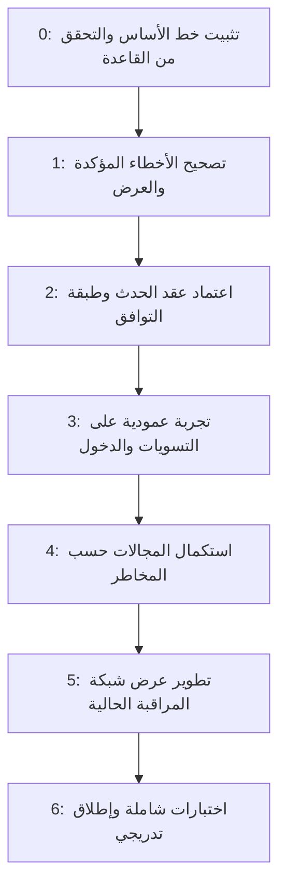

# خطة إعادة صياغة شبكة المراقبة والتحقق من اكتمالها

**تحسين شاشة العرض 042 — كود فقط، 2026-10-28:** نُفذ فلتر `ScreenCode` بقائمة قيم V2، والترتيب التصاعدي من الأقدم إلى الأحدث، ومعاينة طباعة للصفحة المعروضة. لم يتطلب ذلك تعديل مخطط أو بيانات. نجحت 33 فحصًا محليًا وبناء نسخة مستقلة دون أخطاء. تجربة المرشح والمعاينة داخل التطبيق الفعلي ما زالت مطلوبة قبل استبدال التشغيل.

**نقطة تحقق 041 — إيصالات عادية، كود فقط، 2026-10-27:** جُهزت عمليات إنشاء وفتح تعديل وتعديل وإلغاء شاشة `Receipt` للنموذج الذري الجديد، وفُصل سياق العهد صراحةً. نجحت 40 مجموعة اختبار محلية وبناء دون أخطاء. **بناءً على قرار المستخدم، عمليات العهد ما زالت مؤجلة؛ لا تنفيذ SQL أو استبدال لنسخة التشغيل في هذه الجولة.** الخطوة التالية بعد تفويض الاختبار الكتابي: التحقق من سلسلة 031–041، ثم اختبار القبض والصرف والفشل والتراجع والتكرار والتزامن من نسخة منفصلة. [تقرير 041 والتغطية والحدود](Receipt_041_CodeOnly_20261027_AR.md). الحالات التالية تاريخية ولا تعني اكتمال التعميم الحالي.

**نقطة تحقق 040 — كود فقط، 2026-10-27:** نُقلت بقية الاستدعاءات القديمة غير المرتبطة بالإيصالات والعهد المؤجلة؛ انخفض الحصر من 46 إلى **8 استدعاءات في 5 ملفات**. جُهزت 033–040 مع تنقيح 032، بما فيها تصحيح استهداف خصم عرض السعر المعتمد. نجح **2441 تحققًا محليًا**، وفحص 17 ملف SQL بالنحو الخاص بـ2014، وبناء بلا أخطاء. **031–040 غير مثبتة في هذه الجولة؛ لا كتابة SQL ولا استبدال تشغيل. التعميم الشامل غير مكتمل بسبب المسارات المؤجلة والكتابات غير المسجلة سابقًا.** [التقرير والحدود وخطة التحقق](Completion_040_CodeOnly_20261027_AR.md)، [الحصر الحالي](Completion040_20261027/CallSites.md). ما يلي سجل تاريخي لا يصف اكتمال التغطية الحالية.

**نقطة تحقق 032 — كود فقط، 2026-10-27:** نُقلت تسعة استدعاءات قديمة لتغيير حساب الفاتورة والخصم المباشر في Sales وAgentsMenu وViewBill وPch وSBChangePrice، وأضيف تسجيل مسار Percent_Disc. نجح 781 تحققًا غير متصل في 29 مجموعة وبناء دون أخطاء، مع فحص صياغة SQL 2014 للملفات والكاتبين المرشحين كاملين. المتبقي 46 استدعاءً في 24 ملفًا، منها 6 ضمن العهد والإيصالات المؤجلة. **031 و032 غير مثبتتين؛ لا اختبارات SQL كتابية ولا استبدال لنسخة التشغيل. التعميم الشامل غير مكتمل.** العقد لا يشمل اعتماد الفاتورة أو حفظ الرأس المركب أو الدفع أو توزيع الخصم. [التقرير والحدود](Completion032_20261027_Progress_AR.md)، [الحصر](Completion032_20261027/CallSites.md). الفقرات التالية سجل تاريخي.

**نقطة تحقق 031 — كود فقط، 2026-10-27:** جُهّز نقل إضافة أصناف المشتريات والجرد مع التكلفة وأسعار الوحدات وتواريخ الصلاحية إلى معاملة عمل/مراقبة واحدة. نجح 460 تحققًا غير متصل في 28 مجموعة وبناء دون أخطاء. الحصر في المصدر أصبح 55 موضعًا قديمًا في 26 ملفًا بدل 57. **031 غير مثبتة، واختبارات SQL الحية مؤجلة باختيار المستخدم «أكمل الكود فقط حاليًا»؛ لا تعتمد نسخة البناء الجديدة للتشغيل قبل استكمالها.** لم تُستبدل نسخة التشغيل أو تُغير إجراءات الأعمال. [التقرير والحدود](Completion031_20261027_Progress_AR.md)، [الحصر](Completion031_20261027/CallSites.md). العهد والإيصالات مؤجلة، والتعميم الشامل غير مكتمل. الحالات أدناه تاريخية.

**نقطة تحقق 029 و030 — 2026-10-27:** نُقلت إضافة وحذف بنود المصروفات وإضافة الأرصدة السابقة والمرتب اليدوي وإلغاؤها، وصُحح قبول DBNull الاختياري في المرتجعات. نجح 2374 تحققًا، وبناء دون أخطاء وبوابة 20 مجالًا. انخفض الحصر من 65 إلى 57 موضعًا قديمًا في 28 ملفًا. [التقرير والحدود](Completion030_20261027_Progress_AR.md)، [الحصر](Completion030_20261027/CallSites.md). التحديثان مثبتان على CPOS_ACCOUNTING، ونسخة التشغيل الأساسية لم تستبدل. **العهد والإيصالات مؤجلة بقرار المستخدم الأخير؛ التعميم ورؤوس الفواتير غير المسجلة سابقًا لم تكتمل.** الحالات أدناه تاريخية.

**نقطة تحقق 028 — 2026-10-27:** نُقلت إضافة وحذف أصناف المرتجعات، وصُحح استهداف زيادة/نقص الكمية إلى Rtn_Contents وفاتورتها فقط بعد اعتماد الاستكمال. 154 تحققًا للمرتجعات و2180 في الجولة، وبناء دون أخطاء وبوابة 18 مجالًا. انخفض الحصر من 69 إلى 65 موضعًا في 30 ملفًا. [التقرير والحدود](Completion028_20261027_Progress_AR.md)، [الحصر](Completion028_20261027/CallSites.md). 028 مثبتة على CPOS_ACCOUNTING؛ نسخة التشغيل الأساسية لم تُستبدل. **تغطية رأس المرتجع واعتماده وبقية التعميم لم تكتمل؛ الحالات أدناه تاريخية.**

**نقطة تحقق 027 — 2026-10-27:** نُقلت قيم الموظفين (إنشاء/تعديل/إلغاء)، وأزيلت فروع الحفظ القديم الاحتياطية من التسوية وتعديل الكمية، بما فيها كتابات الرأس المباشرة. حصر المتبقي 69 موضعًا بدل 76؛ ومع 026 أغلقت الجولة 19 نقطة في 12 شاشة. 2026 فحصًا ناجحًا (منها 19 فحصًا نصيًا)، وبناء بلا أخطاء وبوابة 17 مجالًا. [التقرير والحدود](Completion027_20261027_Progress_AR.md)، [الحصر](Completion027_20261027/CallSites.md). 027 مثبتة على CPOS_ACCOUNTING دون تغيير إجراءات المرتبات أو بنية الجداول، ونسخة التشغيل لم تستبدل. **التعميم لم يكتمل؛ الحالات أدناه سجل تاريخي.**

**نقطة تحقق 026 — 2026-10-27:** نُقلت 12 نقطة تسجيل لأصناف الاستلام والصرف والتالف والتحويل في تسع شاشات، مع السطر والإجمالي وأرصدة المخزون في معاملة واحدة. 179 تحققًا لهذه المجموعة و1879 في الجولة، وبناء ناجح وبوابة 16 مجالًا. [التقرير والحدود](Completion026_20261027_Progress_AR.md)، [الحصر: 76 موضعًا قديمًا](Completion026_20261027/CallSites.md). 026 مثبتة على CPOS_ACCOUNTING، دون تغيير إجراءات الأعمال أو نسخة التشغيل الأساسية. **التعميم ورؤوس الأذونات غير المسجلة سابقًا لم تكتمل.** الحالات التالية سجل تاريخي.

**نقطة تحقق 025 — 2026-10-27:** نُقلت ثمانية مواضع للإيداع والسحب والتحويل بين الخزائن والحسابات في ثلاث شاشات إلى معاملة عمل/مراقبة واحدة، مع التقاط الأطراف واسترجاع الرقم الفعلي ومنع التكرار. 228 تحققًا لهذه الدفعة و1700 في الجولة، وبناء ناجح وبوابة 15 مجالًا. [التقرير والحدود](Completion025_20261027_Progress_AR.md)، [الحصر: 88 موضعًا قديمًا](Completion025_20261027/CallSites.md). 025 مثبتة على CPOS_ACCOUNTING؛ لا تغيير في جداول الأعمال أو إجراءاتها أو نسخة التشغيل الأساسية. **بقية التعميم لم تكتمل.** الحالات التالية سجل تاريخي.

**نقطة تحقق 024 — 2026-10-27:** نُقلت عملية نقل الطاولة الكاملة من TablesBalance وزيادة/نقص وحذف صنف الطاولة من TB_BillIM إلى معاملة عمل/مراقبة واحدة، مع التقاط الفواتير وطابور الطباعة دون تغيير إجراءات الأعمال. 111 تحققًا و1472 في الجولة، وبناء ناجح وبوابة 14 مجالًا. [التقرير والحدود](Completion024_20261027_Progress_AR.md)، [الحصر: 96 موضعًا قديمًا](Completion024_20261027/CallSites.md). 024 مثبتة على CPOS_ACCOUNTING؛ لم تُستبدل نسخة التشغيل الأساسية. **نقل أصناف مختارة بين الطاولات وتسليم الطلبات وبقية التعميم لم تكتمل.** الحالات التالية سجل تاريخي.

**نقطة تحقق 023 — 2026-10-27:** نُقل حذف الصنف من ItemsMenu وIM_Fast_Mang والتعديل السريع من IM_Fast_Mang إلى معاملة عمل/مراقبة واحدة، مع التقاط التوابع وبيانات الصورة المشتقة. 95 تحققًا و1361 في الجولة، وبناء ناجح وبوابة 13 مجالًا. [التقرير والحدود](Completion023_20261027_Progress_AR.md)، [الحصر: 99 موضعًا قديمًا](Completion023_20261027/CallSites.md). 023 مثبتة على CPOS_ACCOUNTING؛ لم تتغير إجراءات الأعمال أو نسخة التشغيل الأساسية. **إنشاء بطاقة الصنف وتعديلها الكامل وبقية التعميم لم تكتمل.** الحالات التالية سجل تاريخي.

**نقطة تحقق 022 — 2026-10-27:** نُقل إنشاء/حذف فترات العروض ونسب التسعير في OFFERS وIM_Change_Price_ByPercent إلى معاملة عمل/مراقبة واحدة. 88 تحققًا لهذه الدفعة و1266 في الجولة، وبناء ناجح وبوابة 12 مجالًا. [التقرير والحدود](Completion022_20261027_Progress_AR.md)، [الحصر: 102 موضع قديم](Completion022_20261027/CallSites.md). 022 مثبتة على CPOS_ACCOUNTING؛ لم تتغير جداول الأعمال أو إجراءاتها أو نسخة التشغيل الأساسية. **التعميم لم يكتمل**. الحالات التالية سجل تاريخي.

**نقطة تحقق 021 — 2026-10-27:** نُقلت روابط وحدات الأصناف وأسعارها وسعر العرض في خمس شاشات، مع الوحدات الافتراضية والمكونات التابعة والحسم الآمن لإعادة المحاولة. 86 تحققًا جديدًا و1178 تحققًا في الجولة، وبناء ناجح وبوابة 11 مجالًا. [التقرير والحدود](Completion_20261027_Progress_AR.md)، [الحصر: 106 مواضع قديمة](Completion_20261027/CallSites.md). 021 مثبتة على CPOS_ACCOUNTING؛ لا تغييرات على جداول الأعمال أو إجراءاتها، ولا استبدال للتشغيل. **التعميم لم يكتمل**؛ رأس العرض وتعديلات النسب وبقية المجالات ما زالت متبقية.

**نقطة تحقق 020:** اكتمل نقل إنشاء/تعديل/حذف التصنيفات وربط/فك ربط الطابعات الإضافية، مع الإنشاء السريع من شاشتي الأصناف. 61 تحققًا وبناء ناجح وبوابة 10 مجالات. [التقرير](Completion_20261026_Progress_AR.md)، [الحصر: 110 مواضع قديمة](Completion_20261026/CallSites.md). التعميم ما زال جاريًا؛ ليس العدد شهادة شمول للمسارات غير المسجلة سابقًا.

**نقطة تحقق 019:** نُقلت مراقبة تعريف الوحدات (إنشاء/تعديل/حذف)، بما فيها الإنشاء المساعد من ثلاث شاشات، إلى معاملة ذرية. 62 تحققًا وبناء ناجح وبوابة 9 مجالات. [التقرير](Completion_20261026_Progress_AR.md)، [الحصر: 114 موضعًا قديمًا](Completion_20261026/CallSites.md). التعميم لم يكتمل؛ إجراءات حذف الوحدات التجارية لم تُصحح. الفقرات التالية سجل النقاط السابقة.

مرجع الخطة: [تقرير المراجعة](Network_Tracker_Audit_AR.md). بدأت الخطة بالتنفيذ؛ حالة كل دفعة موثقة بصورة مستقلة ولا يعني بدء التنفيذ اكتمال المراحل التالية.

**نقطة الاستكمال 018 — 2026-10-26:** رُبط الإلغاء الذري في 17 شاشة، وطُبّق عقده على CPOS_ACCOUNTING دون تصحيح إجراءات الإلغاء وفق اختيار المستخدم. أُضيف سجل استعادة محلي مستقل باختياره، دون تنفيذ Restore حقيقي. اجتاز الإلغاء 149 تحققًا والمحلي 34 والأمن 40 والانحدار 726؛ البناء والبوابة ذات المجالات الثمانية ناجحان. الحصر **118 موضعًا قديمًا متبقيًا**؛ التكليف الشامل غير مكتمل ولا تُستبدل نسخة التشغيل. [التقرير والقرارات والحدود](Completion_20261026_Progress_AR.md).

**الأحدث — 4F/017 — 2026-10-26:** نُقلت إضافة/دمج أصناف POS وSales_Fast وSB_IM_card/Sales إلى معاملة V2 تشمل السطر والمكونات والأرصدة وإعادة الحساب أثناء التعديل، مع طلب ثابت للاستعادة. SQL 017 مطبقة على CPOS_ACCOUNTING؛ **726 تحققًا** وبناء كامل ناجح. نسخة تجربة جديدة مستقلة، دون استبدال التشغيل. [التقرير والحدود](Phase4F_Sales_Addition_AR.md)، [الحصر: 130 موضعًا قديمًا](Phase4F/CallSites.md). **التعميم الشامل لم يكتمل**؛ الفقرات التالية تاريخية.

**الأحدث — تصحيح المكونات 015/016 — 2026-10-26:** بعد اعتماد المستخدم، صُححت مكونات الإضافة/الدمج/الحذف وحالة أمر البيع، وأُغلق مسار تعديل الوحدة/الكمية المباشرة مع تفاصيل مراقبته. الملفان مطبقان على CPOS_ACCOUNTING؛ **644 تحققًا** وبناء كامل دون أخطاء جديدة، دون إعادة حساب التاريخ أو استبدال نسخة التشغيل الأساسية. [التقرير والأوامر والحدود](Components015_016_Result_AR.md). اعتماد تصحيح المكونات حُسم؛ الفقرات التالية تاريخية. **نقل الإضافة/الدمج نفسه إلى طلب مراقبة ذري لا يزال متبقيًا** والحصر 133 موضعًا قديمًا.

**الاستكمال الشامل المعتمد — نقطة تحقق 4E — 2026-10-26:** وافق المستخدم على استكمال جميع المسارات المتبقية كتكلـيف واحد، مع اختبارات داخلية متدرجة ودون استبدال نسخة التشغيل. نُقل حذف صنف البيع في الشاشات الثلاث وتوابعه إلى معاملة ذرية؛ 014 مطبقة والمجال السابع مفعّل. نجح 75 تحققًا جديدًا و445 انحدار وبناء كامل. طُبق أيضًا تصحيح استهداف الفاتورة 013 بموافقة صريحة، دون إعادة حساب التاريخ. [التقرير](Phase4E_Sales_Deletion_AR.md)، [الحصر: 133 موضعًا قديمًا](Phase4E/CallSites.md). **التعميم لا يزال جاريًا**؛ الإضافة وبقية دورة البيع والمجالات المتبقية لم تُنقل بعد. مشكلة بقاء المكونات عند الحذف خارج وضع التعديل موثقة ولم تُصلح دون اعتماد.

**الحالة الأحدث — 4D — 2026-10-26:** نُقلت `Change_IM_Qty` (+/-) في Sales وSales_Fast وPOS إلى معاملة ذرية تشمل قيم السطر والرأس ومكوناته وأرصدة المخزون، مع طلب ثابت وتقسيم التفاصيل دون اقتطاع. 012 مطبقة على `CPOS_ACCOUNTING` والمجال السادس `Sales.LineQuantity` مفعّل. نجح **91 تحققًا جديدًا + 354 انحدار = 445**، والبناء الكامل دون أخطاء، واختبار SQL للبوابة ذات المجالات الستة بـRollback. [تقرير 4D](Phase4D_Sales_Quantity_AR.md) يوثق نسخة التجربة وحدودها وملاحظة خصم السطر القديمة. [الحصر](Phase4D/CallSites.md): **136 موضعًا قديمًا مترجمًا**؛ الإضافة والحذف والطاولات ودورة الرأس والمدفوعات لم تُنقل بهذه الدفعة. تجربة الواجهة والانقطاع الفعلي والضغط متبقية؛ الحالات أدناه تاريخية.

**الحالة الأحدث — 4C — 2026-10-26:** نُقل تعديل تفاصيل صنف البيع من `Change_IM_Details` في Sales/Sales_Fast، وتغيير سعره من `SBChangePrice` في POS، إلى معاملة ذرية تسجل 25 قيمة فعلية قبل/بعد. 011 مطبقة على `CPOS_ACCOUNTING` ومجال `Sales.LineEditing` مفعّل. نجح 70 تحققًا جديدًا و284 تحقق انحدار وبناء كامل دون أخطاء. [الحصر](Phase4C/CallSites.md): 139 موضعًا قديمًا مترجمًا؛ `+/-` والإضافة/الحذف ودورة الرأس ليست منقولة بهذه الدفعة. [تقرير 4C](Phase4C_Sales_Line_Editing_AR.md) يوثق الحدود، نسخة التجربة، وملاحظة خصم السطر القديمة في POS. اختبار تبديل البوابة المعدلة وتجربة الواجهة متبقيان؛ الحالات التالية تاريخية.

**الحالة الأحدث — 4B / النقل الكامل والآمن على دفعات — 2026-10-26:** اعتمد المستخدم النقل الذري وليس جسر رسائل بعد الحفظ. نُقل فتح تعديل 11 نوع مستند في 11 شاشة (12 اقتران نوع/شاشة) إلى `Document.EditOpened`، وطُبقت 010 على `CPOS_ACCOUNTING` ومجال `Documents.EditOpening` بجانب المجالات الثلاثة السابقة. نجح 142 تحققًا جديدًا و142 تحقق انحدار وبناء كامل بلا أخطاء. [الحصر](Phase4B/CallSites.md) أصبح 141 موضع استدعاء قديم مترجم، وليس اكتمال النقل. [تقرير 4B وخطة دفعات الاستكمال](Phase4B_Document_Opening_AR.md) هو المرجع الحالي؛ الحالات اللاحقة تاريخية. المسودات وOffline مستبعدان كما اتُفق، والفجوات بلا استدعاء قديم مشمولة بخطة الاستكمال.

**الحالة الأحدث — 4A / الشاشة الأساسية وفتح تعديل المبيعات — 2026-10-26:** أصبحت شاشة V2 المدخل المباشر من الإعدادات، واستُبعدت الشاشة القديمة من البناء وأصبحت القراءة V2 فقط. نُقلت بداية فتح تعديل الفاتورة في `Sales` و`POS` و`Sales_Fast` إلى معاملة عمل/حدث واحدة، وطُبقت 009 ومجال `Sales.EditOpening` في `CPOS_ACCOUNTING`. نجح 142 تحققًا وبناء كامل بلا أخطاء. **الإلغاء الشامل للكاتب القديم لم يكتمل**؛ الحصر يتضمن 144 موضع استدعاء في ملفات مترجمة، منها فروع احتياطية. التفاصيل والتغطية ونسخة التشغيل في [تقرير 4A](Phase4A_Primary_Cutover_AR.md). جميع الحالات التالية تاريخية.

**الحالة الأحدث — 3D / إغلاق فجوات سطور التسوية — 2026-10-26:** نُفذت حماية الرصيد القديم داخل معاملة الحفظ، واستُبدل مدخل تعديل السطر غير المدعوم بنافذة `IM_Update_Qty` بوضع تعديل فرق السطر، وأضيف فحص الصلاحية/الإلغاء/جلسة تعديل المستند المعتمد في SQL. طُبقت 008 على `CPOS_ACCOUNTING` دون تعديل بنية الجداول، مع بقاء الأثر الفوري. نجح **47 تحققًا** للسلامة والتزامن والتراجع، و**22** للسياسة/السطور و**7** لوحدات الرأس. بُنيت نسخة Runtime كاملة بلا أخطاء؛ تجربة الواجهة بالنسخة الحديثة ما زالت مطلوبة. تفاصيل الملفات والحدود في [دليل التشغيل، قسم 3D](Pilot_Activation_AR.md). الحالات السابقة أدناه سجلات تاريخية وليست بديلًا لهذه الحالة.

**آخر تحديث — تجربة التشغيل المحدودة / 2026-10-25:** بناء CPOS كامل في `.tmp/AuditPilot_20261025_01/Runtime` مع حفظ نسخة التشغيل السابقة؛ تفعيل `Security` و`Inventory.Settlement` على `CPOS_ACCOUNTING` بعد اختبار البوابة وفحص غياب الجلسات. النسخة الأصلية لم تستبدل وتجربة الواجهة بعد التفعيل ما زالت بانتظار المستخدم. تفاصيل التشغيل والتراجع والتحذيرات في [دليل تجربة التشغيل](Pilot_Activation_AR.md). إشارات «المجالات معطلة» أدناه تصف نهاية الدفعات السابقة قبل هذا التفعيل المحدود، وليست الحالة الحالية.

**حالة التنفيذ — 2026-10-13:** أُنجز التحقق المباشر من تعريفات قاعدة التطبيق وخط الأساس، وطُبقت إصلاحات المرحلة الأولى في المصدر. نجحت اختبارات البحث وترجمة كود المشروع؛ تجربة مسارات الأعمال من الواجهة والنشر لم تُنجزا بعد. لم تُطبق تغييرات على القاعدة الحية. التفاصيل والحدود في [تقرير المرحلة 0 والمرحلة 1](Phase0_Phase1_Result_AR.md)، والتغطية المرحلية في [سجل التغطية](Coverage_Register_AR.md).

**تحديث المرحلة الثانية — 2026-10-24:** بعد اعتماد المستخدم `CPOS_ACCOUNTING` للاختبار، نُفذت **2A: البنية وقارئ التوافق والشاشتان** ثم **2B: الكاتب ومنسق الطلبات واختبارات المعاملات**. أُنشئت أربعة إجراءات إضافية واختُبرت على بيانات اصطناعية، وأُعيد تعطيل جميع المجالات. لم يُنقل أي مسار بيع أو مخزون أو دخول إلى الكاتب بعد. ما زالت شروط تجربة التسويات في [عقد الحدث والكاتب وسياسة الفشل](Phase2_Audit_Contract_AR.md) سارية.

**الحالة الأحدث — 3C / رأس التسوية والأثر الفوري — 2026-10-24:** اعتمد المستخدم «الحفاظ على التأثير الفوري الحالي». نُفذت ترقية 006 في `CPOS_ACCOUNTING` وربط الرأس في المصدر، ونجح 55 تحققًا للرأس/المخزون مع اختبارات انحدار المراحل السابقة. جميع المجالات لا تزال معطلة؛ تجربة الواجهة والتزامن الفعلي والتفعيل المحدود لم تنفذ بعد. التفاصيل في نتيجة 3C أدناه، ولا يعد هذا إعلان اكتمال المرحلة الثالثة أو نشرًا عامًا.

**مراجعة 3C التمهيدية:** أثبت فحص القراءة أن سطور التسوية تؤثر قبل الاعتماد وأن الملغى لم يكن مستبعدًا، وفحص السالب يستدعي جداول المشتريات. احتُفظ بوصف هذه المراجعة تاريخيًا أدناه؛ أعقبها قرار المستخدم والتنفيذ الموضح في نتيجة 3C.

**تحديث النطاق بناءً على قرار المستخدم:** تحسين مراقبة المسودات والعمل دون اتصال مؤجل إلى مرحلة متقدمة مستقلة. لا يتوقف بدء التحسينات الحالية أو اعتمادها على تنفيذ هذا المسار.

## نتيجة الدفعة 2A — 2026-10-24

### المنفذ

- إنشاء `Network_Audit_Source` و`Network_Audit_Request` و`Network_Audit_Event` و`Network_Audit_Change` في **CPOS_ACCOUNTING فقط** باستخدام `Database/Audit/002_Create_Audit_V2_ReadModel.sql`، بتوافق SQL Server 2014. معرف المصدر ثابت محفوظ في صف إعداد واحد، ومنطقة العرض `Libya Standard Time`، و`EnabledDomainsXml` فارغ. لم يُعدل جدول أعمال أو جدول المراقبة القديم أو إجراء تسجيله.
- `Classes/Audit/AuditCompatibilityReader.vb`: قراءة قديم/V2 بمرشحات typed، و100 صف لكل صفحة، وتفاصيل بمعرف الحدث أو معرف السجل القديم. الربط مع تعريفات المستخدم/الشاشة/العملية اختياري حتى لا تختفي السجلات غير المصنفة.
- `Forms/Audit/Network_Audit_Browser.vb` وملف Designer: شاشة بحث مستقلة للفترة ونوع السجل والنتيجة والمستخدم والمستند والشاشة/المجال والوصف. تعرض حالات التحميل والفشل في الشريط السفلي، ولا تستبدل النتائج إلا بعد نجاح القراءة. لا تعدل الواجهة أي بيانات.
- `Forms/Audit/Network_Audit_Details.vb` وملف Designer: الوصف والهوية والأوقات ومراجع الكيانات المحفوظة، مع جدول قبل/بعد ومصدر القيمة. تميز بين غير ملتقط/غير موجود/NULL/قيمة، ولا تولّد بيانات تاريخية من الوضع الحالي.
- زر **«المراقبة الجديدة والتفاصيل»** في `Forms/Network_Tracker` يفتح الشاشة المستقلة. العرض الجديد للمدير المسجل فقط في هذه الدفعة، مع تحقق عند الفتح والبحث والتفاصيل. لا توجد صلاحيات تصدير مستقلة أو تصدير جديد بعد، ولا يستبدل ذلك صلاحيات قاعدة البيانات.
- إضافة الملفات إلى `resturant.vbproj` دون تعديل ربط المسودات أو الكاتب القديم أو حسابات المخزون/المبيعات.

### نتائج التحقق

- بقي السجل القديم **462 حركة**. جرى المرور على صفحاته الخمس والتحقق من وصول جميع المعرفات دون فقد أو تكرار.
- أنشأ الاختبار طلبًا و205 أحداث وثلاثة تغييرات **داخل معاملة أُلغيت بـRollback**. نجح البحث بالمحارف الخاصة، والتصفية حسب النتيجة والمستند، وتقسيم الصفحات 100/100/5، وتحميل التفاصيل، ورفض تكرار ترتيب الحدث داخل الطلب ورفض تناقض حالة NULL مع قيمة فعلية. لم تبقَ سجلات اختبار في الجداول الثلاثة.
- أرقام `IDENTITY` التي استهلكها اختبار Rollback قد تترك فجوات؛ هذا طبيعي، ولا يُعاد ضبطها. ليست هذه الأرقام عدادًا لعدد العمليات المحفوظة.
- نجح اختبار فشل تحديث الاتصال دون حلقة إعادة محاولة، مع بقاء النتائج السابقة وإعادة تمكين أدوات الشاشة.
- نجح `Test_Phase2A.ps1 -LiveReadOnly -RollbackWriteTests -RenderScreens`: **46 تحققًا**، ونجحت اختبارات المرحلة الأولى المحلية: **23 تحققًا**.
- نجح `ResolveReferences;CoreCompile` للمشروع بمخرجات معزولة تحت `.tmp/AuditPhase2A`، مع خمسة تحذيرات سابقة خارج الملفات الجديدة. هذا فحص ترجمة، وليس Rebuild/نشرًا كاملًا، ولم تستبدل نسخة التطبيق في `bin/Debug`.
- فُحصت صور التصميم ببيانات نموذجية عند 1024×650 و980×600 للبحث و960×620 للتفاصيل. لم تُجرَ تجربة تفاعلية كاملة من نسخة التطبيق لدى المستخدم أو اختبار مصمم Visual Studio نفسه؛ ما زالت مطلوبة قبل النشر.

لإعادة الاختبار من جذر المستودع:

```powershell
# اختبارات محلية فقط، دون اتصال أو كتابة قاعدة
& '.\resturant\Documentation\NetworkTrackerReview\Test_Phase2A.ps1' -RenderScreens

# قراءة القاعدة المصرح بها
& '.\resturant\Documentation\NetworkTrackerReview\Test_Phase2A.ps1' -LiveReadOnly

# اختبار كتابة مؤقتة: CPOS_ACCOUNTING فقط، بعد تأكيد أنها قاعدة الاختبار
& '.\resturant\Documentation\NetworkTrackerReview\Test_Phase2A.ps1' -LiveReadOnly -RollbackWriteTests -RenderScreens
```

لا تعِد تشغيل ملف الإنشاء على القاعدة المثبتة؛ يرفض وجود أي من الجداول الأربعة عمدًا بدل حذفها أو الكتابة فوقها. ملفات الاختبار لا تنشر مع التطبيق ولا تُدرج مصادرها في vbproj.

### حدود يجب عدم تجاوزها

1. **لا توجد أحداث أعمال V2 فعلية حتى الآن**؛ كل مسارات الإنتاج ما زالت تستخدم المراقبة القديمة. ظهور «قبل/بعد» الحقيقي يبدأ بعد نقل المسار وحفظ تلك القيم، لا بمجرد تثبيت الشاشة.
2. القديم بلا منطقة زمنية أو نتيجة موثقة؛ يعرض كما حُفظ. الجديد يحوّل UTC إلى منطقة العرض. الترتيب: V2 ثم القديم، والأحدث داخل كل نوع؛ ليس ترتيبًا زمنيًا عالميًا مثبتًا بين ساعتين مختلفتين. تحديد نتيجة نجاح/رفض يستبعد القديم بوضوح.
3. حد أعلى للمعرفات يقلل تغير الصفحات عند الإضافة العادية، لكنه **ليس Snapshot دائمًا**؛ التعديل أو الحذف أو مزامنة قديمة بمعرف أقل يمكن أن يغيّر النتائج. البحث من جديد يعيد الالتقاط. العدد والصفحة يُشتقان من نفس مجموعة مؤقتة لكل استعلام.
4. لا يمنع هذا الإصدار التعديل المباشر بواسطة حساب SQL ذي صلاحيات كتابة. قيود الإدخال ليست بديلًا عن كاتب المعاملة أو سياسة صلاحيات/احتفاظ معتمدة.
5. لا يوجد تفعيل أو مزامنة تلقائية للجداول الجديدة. لا يُفعّل V2 على بيئة متعددة المصادر قبل اختبارات التوافق. المسودات وOffline خارج هذه الدفعة.

**نهاية 2A تاريخيًا:** كانت الخطوة التالية تنفيذ الكاتب؛ أُنجزت الدفعة 2B المبينة أدناه. لا تمثل اختبارات الجداول وحدها إثباتًا لسلامة مسار أعمال لم يُنقل بعد.

## نتيجة الدفعة 2B — الكاتب ومنسق الطلبات — 2026-10-24

### الملفات والبنية

- `Models/Audit/AuditEventContext.vb`: لقطة المصدر والفاعل والجلسة والجهاز والشاشة. لا يقرأ الكاتب `USER_ID` أو إعدادات الاتصال العامة من تلقاء نفسه.
- `Models/Audit/AuditFieldChange.vb`: حالات القيمة الأربع، والتقاط الأنواع صراحة دون تقريب عرض أو تحويل Float إلى Decimal. `Nothing` ليس بديلًا عن حالة NULL؛ تستخدم `AuditValue.Missing` للحالات غير ذات القيمة.
- `Models/Audit/AuditEventRequest.vb`: طلب العملية والحدث ومراجع الكيانات ونتائج الكتابة/الاستعلام.
- `Classes/Audit/AuditContract.vb`: قائمة مغلقة للأفعال والمدخلات والحقول والأنواع المسموحة، والتحقق من هوية المستخدم والجلسة وحدود الحجم.
- `AuditCanonical.vb`: ترميز ثابت بإصدار 1 وSHA-256 في .NET، مع XML مولد من نماذج typed ومنع DTD والكيانات الخارجية. لا يستعمل HASHBYTES للحمولات الطويلة على SQL Server 2014.
- `AuditMessageFormatter.vb`: قوالب عربية إصدار 1، تُحفظ الرسالة الناتجة وقت الحدث. لا توجد رسالة حرة أو قائمة حقول غير مقيدة في واجهة الكاتب الحالية.
- `AuditRequestCoordinator.vb`: Begin/Complete/Status وسياق طلب يتبع الاتصال والمعاملة نفسيهما. سياق المستدعي يُنسخ عند البدء؛ تغيير مدخلات الطلب المحجوز يرفض، وفشل الكتابة يجعل السياق غير قابل للإكمال.
- `AuditWriter.vb`: كتابة داخل معاملة المستدعي، وحفظ مستقل للأحداث الأمنية فقط. لا استبدال لـ`SQL_SP_EXEC` أو `Network_Edit_Tracker_insert`.
- `Database/Audit/003_Create_Audit_V2_Writer.sql`: **طُبق بالفعل على CPOS_ACCOUNTING**؛ أنشأ `Network_Audit_Request_Begin` و`Network_Audit_Event_Write` و`Network_Audit_Request_Complete` و`Network_Audit_Request_Status`. لا جداول إضافية ولا تغيير في جداول/إجراءات الأعمال. الإنشاء ذري ويرفض إعادة الكتابة فوق إجراءات موجودة.
- أُضيفت مصادر VB إلى `resturant.vbproj`. ملفات الاختبار مستقلة وخارج مصادر التطبيق.

### الاستخدام الملزم عند نقل مسار في المرحلة 3

1. إنشاء `RequestId` مرة واحدة **قبل الإرسال** وحفظه مع مدخلات الأمر خلال إعادة المحاولة. لا تنشئ معرفًا جديدًا لمجرد Timeout أو فقد الرد.
2. فتح اتصال العمل ومعاملته ثم `AuditRequestCoordinator.Begin` **قبل تعديل بيانات الأعمال**. إذا كانت `MustExecute=False` تعاد النتيجة المحفوظة ولا يُستدعى إجراء الأعمال مجددًا.
3. عند الطلب الجديد تُنفذ عملية العمل بنفس الاتصال والمعاملة، وتُقرأ اللقطات والمعرفات الفعلية منهما. لا قراءة لاحقة من Grid ولا `MAX(T_ID)` للحصول على معرف السطر.
4. وقت نجاح الأعمال يؤخذ عبر `ServerUtcNow` بعد العمل داخل المعاملة. يلزم UTC ودقة مللي ثانية؛ تاريخ المستند والقيم الزمنية الأصلية تحفظ دون افتراض منطقة زمنية لها.
5. استدعاء `WriteInTransaction` لكل حدث ثابت الهوية والترتيب. النتيجة `AddedPendingCommit` لا تعني أن العمل التزم؛ `AlreadyPresent` تعني إعادة الحدث نفسه داخل الطلب النشط فقط.
6. استدعاء `Complete` بالنتيجة ومعرفات النتائج المسموحة، ثم **المستدعي وحده** ينفذ Commit. أي استثناء يفرض Rollback لوحدة العمل؛ لا يجوز التقاط خطأ الكاتب ثم اعتماد الأعمال بدونه. الكاتب لا يستطيع منع كود خارجي من استدعاء `SqlTransaction.Commit` مباشرةً؛ الالتزام بنمط الاستدعاء واختباره لكل مدخل شرط للضمان.
7. لا تظهر رسالة نجاح ولا تنفذ الطباعة/الإشعارات قبل Commit. إذا فشل الرد عند Commit فالحالة غير مؤكدة؛ يستخدم `Status` من اتصال جديد وبالطلب نفسه. لا تحويل لتعذر الاستعلام إلى فشل أعمال مفترض.

`WriteIndependent` يملك معاملة قصيرة للأمن فقط، ويرفض حدث الأعمال. بدء الجلسة/رفض الدخول/الخروج الصريح لها قوالب أولية معتمدة، لكن شاشات الدخول والخروج الحالية **لم تُعدل**. قائمة أحداث التسوية الحالية تقتصر على `Settlement.LineAdded` تمهيدًا للمرحلة 3؛ قوالب الحذف والاعتماد والإلغاء وبقية العمليات تضاف مع نقل مساراتها، لا يُفعّل المجال كاملًا الآن.

### نتائج الطلب والاستعلام

| الحالة | معناها والتصرف |
|---|---|
| `NewPendingCommit` | طلب جديد محجوز داخل المعاملة؛ يسمح بتنفيذ العمل مرة واحدة |
| `Completed` | نتيجة طلب ملتزم محفوظة، تعاد دون تنفيذ جديد |
| `NotFound` | لا سجل ظاهر بعد انتظار القفل؛ ليست بمفردها دليلًا على فشل عملية عند انقطاع؛ إعادة المحاولة إن تقررت تستخدم نفس المعرف |
| `InProgressOrUnknown` | تعذر الحصول على قفل الطلب ضمن المهلة؛ لا يُعلن فشل العملية ولا تبدأ بهوية جديدة |
| `IncompleteCommitted` | وجد طلب جارٍ التزم به مستدعٍ بالمخالفة للعقد؛ يتوقف لإجراء مراجعة ولا يعاد تنفيذه تلقائيًا |
| استثناء اتصال/SQL | يبقى استثناءً؛ لا نتيجة نجاح ولا NotFound مصطنعة |

أرقام أخطاء الإجراءات: `51100` معاملة/قفل ملكية، `51101` عقد/حجم، `51102` مصدر/مجال معطل، `51103` انتظار الطلب، `51104` تعارض هوية مع المحتوى، `51105` طلب ناقص/مكتمل في موضع غير مسموح. ليس كل خطأ صالحًا لإعادة المحاولة. قفل الطلب بـ`sp_getapplock` خاص بـSourceId+RequestId؛ لا يحل تعارض طلبين مختلفين يعدلان المستند نفسه، الذي يبقى مسؤولية مسار الأعمال.

### الترميز والحدود

- كل Token: طول Int32 little-endian لبايتات UTF-8 بلا BOM، ثم البايتات؛ `-1` يميز NULL و`0` يميز النص الفارغ. البداية `CPOS-AUDIT/1` ثم نوع الحمولة.
- ترتيب الطلب ثابت في `RequestBytes`: المصدر، الطلب، الفعل، نوع/رقم/خدمة الفاعل، الجلسة، الشاشة، نوع/معرف الكيان، عدد المدخلات، ثم المدخلات بترتيب اسم Ordinal. لكل مدخل الاسم والنوع والحالة والقيمة. لا وقت إعادة إرسال ولا اسم مستخدم مترجم في بصمة الطلب.
- حمولة الحدث تشمل السياق والوقت والمعرفات والسبب والقالب والرسالة والعلاقات والتغييرات المرتبة؛ تستبعد LocalSequence وRecordedAtUtc المولدين بالتخزين. النصوص لا تُقص ولا يعاد ترتيبها بثقافة الجهاز.
- الفحص عند إعادة الإرسال يجمع البصمة والطول والبايتات الكاملة. البصمة ليست توقيعًا أمنيًا ولا حماية من مسؤول قاعدة بيانات يملك الكتابة المباشرة.
- حدود الإصدار الأول: حمولة مقننة 1 MiB، كل XML بحد 262144 حرفًا، 100 حدث لكل طلب، 100 تغيير لكل حدث، 32 مدخل طلب، 32 علاقة، 4096 حرفًا لكل قيمة. حدود أسماء الحقول/السياق تطابق الجداول. تجاوز الحد يرفض؛ التقسيم إلى طلبات/أحداث إضافية لا يتم تلقائيًا.
- القيمة Decimal تحفظ `G29` بثقافة ثابتة؛ Float من Double بصيغة `R` مع رفض NaN/Infinity. التاريخ لا يُحوّل ضمنيًا إلى منطقة أخرى.
- حقول بيانات الاعتماد ليست ضمن القائمة المسموحة. لا كلمة مرور أو تشفيرها أو بصمتها أو حمولة SQL خام في طلب الأمن. الاسم/معرف المستخدم المؤكد فقط؛ رفض بيانات اعتماد مجهولة لا يحمل مستخدمًا أو جلسة سابقة.
- `NoChange=5` يكمل طلب أعمال دون أحداث تغيير؛ النتائج الأخرى تتطلب أحداثًا متطابقة النتيجة، والإكمال يتحقق من معرفات الأحداث التي يعيدها.

### الاختبارات المنفذة وحدود الإثبات

نجح `Test_Phase2B.ps1 -LiveWriteTests`: **59 تحققًا** تشمل متجه ترميز كامل ثابت، SHA-256 معروف، العربية وتغير الثقافة، حمولة تتجاوز 8000 بايت، NULL/الأنواع، منع XML DTD، السياق الأمني، رفض المجال المعطل، Commit/Rollback، إعادة الطلب والحدث، تعارض المحتوى، فشل SQL في الحدث، رفض اتصال/معاملة مختلفة، طلبين متزامنين بنفس الهوية، حالة قيد المعالجة، لا تغيير، طلب ناقص ملتزم، الحفظ الأمني المستقل، واستعادة نتيجة الطلب حتى بعد تعطيل المجال. اختبار المقارنة الكاملة مرر عمدًا نفس البصمة مع بايتات مختلفة وتحقق من الرفض.

استخدمت الاختبارات جدول عمل **مؤقتًا عالميًا باسم عشوائي** لمحاكاة أثر الأعمال؛ لا تعديل لجدول مخزون أو بيع أو مستخدم. فُعّل `AuditTest` ولفترة محدودة `Security` للأحداث الاصطناعية فقط، ثم أُعيد إعداد المجالات السابق. أُزيلت الطلبات/الأحداث/التغييرات التي أنشأتها الاختبارات بمعرفاتها المحددة فقط؛ هذا تنظيف fixtures وليس سياسة لحذف التدقيق الحقيقي. بقي السجل القديم 462 حركة. الملفات `Recovery_*.xml` تحت `.tmp/AuditPhase2B` تسجل هويات الاختبار وحالة تنظيفه دون أسرار اتصال، وتفيد في الاسترداد المحدد عند تعطل الاختبار. لا تشغّل هذه الاختبارات على الإنتاج.

أُعيدت اختبارات قراءة 2A (26 تحققًا) والمرحلة الأولى المحلية (23 تحققًا) بنجاح. نجحت ترجمة المشروع إلى مجلد منفصل، مع التحذيرات الخمسة السابقة فقط. لم تُستبدل نسخة التشغيل، ولم يُنفذ Rebuild/نشر شامل.

**حدود مهمة:** اختبار فقد الرد تم بمحاكاة إعادة الطلب بعد Commit ناجح وعدم استخدام نتيجته، وليس بقطع الشبكة فعليًا أثناء Commit. لم تُختبر بعد عمليتان مختلفتان على صف مخزون حقيقي، أو مصدر مستنسخ/مزامنة متعددة المصادر، أو استعادة القاعدة، أو صلاحيات SQL مقيدة. اختبار نجاح الكاتب ليس اعتمادًا لمسارات الأعمال غير المنقولة. لا توجد محاولة إعادة إرسال تلقائية أو طابور Offline.

لإعادة الاختبار محليًا:

```powershell
& '.\resturant\Documentation\NetworkTrackerReview\Test_Phase2B.ps1'
# يتضمن كتابة/Commit وتنظيف بيانات اصطناعية في CPOS_ACCOUNTING المخصصة للاختبار:
& '.\resturant\Documentation\NetworkTrackerReview\Test_Phase2B.ps1' -LiveWriteTests
```

خيار `-InstallProcedures` لتثبيت جديد فقط؛ **لا تشغله الآن على CPOS_ACCOUNTING لأن الإجراءات أُنشئت بالفعل**. لإيقاف الكاتب لا تحذف الأحداث أو الجداول؛ تبقى المجالات معطلة ولا ينقل المستدعي إلى المسار الجديد.

**تحديث 2026-10-24 — الدفعة 3A: ربط الدخول والجلسات في المصدر.** بدأت المرحلة الثالثة بالدخول أولًا، لأن تدقيق التسويات يحتاج جلسة مؤكدة. لا تعني هذه الدفعة اكتمال المرحلة الثالثة أو نقل عمليات المخزون.

### ما نُفذ في 3A

- `AuditSecuritySession.vb`: بوابة تفعيل تقرأ القاعدة الحالية، وسياق جلسة مؤكد خاص باتصالها ومستخدمها، وحفظ مستقل للأحداث الأمنية عبر كاتب 2B. لا يقبل المساعد كلمة المرور أو تشفيرها أو بصمتها. لا توجد ملفات انتظار محلية أو طابور Offline.
- `login.vb`: التحقق من المستخدم في متغير محلي؛ لا تتغير `USER_ID` و`USER_NAME` قبل السماح وتأكيد بدء الجلسة عندما يكون مجال Security مفعّلًا. إغلاق اتصال التحقق قبل عرض MainForm، وتمرير كلمة المرور المشفرة بمعامل SQL دون تغيير طريقة التشفير. إزالة إنشاء MainForm الثاني الذي كان يتجاوز إعداد النسخة الأولى، ومنع تداخل محاولات الدخول.
- `Saleslogin.vb`: أصبح مسار تبديل المستخدم داخل POS جزءًا من نفس المراقبة حتى لا تبقى جلسة المستخدم السابق. يفحص السماح والوردية وصلاحية المبيعات للمرشح قبل تبديل المتغيرات العامة. مصادر القرار هي نفس `Check_For_OpenPierod` و`Users_Validations_V.Sales`. فُحص الإجراء الحي ووجد SELECT فقط؛ لم يُعدل.
- `MainForm.vb` و`login.FormClosed`: تسجيل نهاية الجلسة عند الخروج الصريح/إغلاق التطبيق، مرة واحدة حتى لو مر الخروج بالنافذتين. في login يحدث ذلك قبل استدعاء `Kill_All_Processes` الموجود أصلًا. فشل تسجيل النهاية يعطي تحذيرًا ولا يعيد فتح الجلسة محليًا. إغلاق النظام القسري أو فشل إنشاء الواجهة لا يصطنع حدث خروج صريح.
- توسعت أسباب `Security.LoginRejected` في العقد والقالب لتشمل `NoOpenPeriod` و`SalesPermissionDenied`، إلى جانب `InvalidCredential` و`UserNotAllowed`. الرفض غير المطابق مجهول بلا مستخدم/اسم/جلسة؛ الرفض بعد تحديد المستخدم يحمل هويته دون جلسة. أسباب POS لها رسائل عربية تشرح منع الوردية أو الصلاحية. لا يلزم تغيير بنية SQL أو الإجراءات لهذه الأسباب؛ الإجراء القائم يخزن ReasonCode أصلًا.

### سياسة النتيجة والفشل

1. قاعدة قديمة **تم التحقق من عدم وجود بنية V2 فيها**، أو Security معطل صراحة: يستمر الدخول القديم دون اختراع جلسة تدقيق. عدم توفر الاتصال، نقص الجداول، إصدار غير مدعوم أو تعذر قراءة الإعداد لا يُفسر بأنه تعطيل.
2. Security مفعّل: لا تُنشر الجلسة قبل تأكيد Commit. عند فقد الرد تُقرأ حالة **نفس RequestId**. إذا لم تُحسم، تبقى المحاولة في الذاكرة بهوية الطلب/الحدث/الوقت نفسها، ويتطلب تكرارها المستخدم والاتصال والمدخل أنفسهم. لا ينشأ طلب بديل ولا يسمح تعطيل المجال بتجاوز محاولة معلقة. انتهاء البرنامج لا يحفظ هذه المحاولة محليًا؛ قد يبقى بدء جلسة بلا نهاية مؤكدة، وهذا يُعرض كما هو.
3. تبديل المستخدم: يُؤكد بدء جلسة الجديد أولًا؛ ثم تسجل نهاية جلسة القديم بلقطته المحفوظة. هذان **طلبان مستقلان وليس معاملة واحدة**. فشل كتابة نهاية القديم لا يلغي بدء الجديد المؤكد؛ يظهر تحذير وقد يبقى القديم بلا نهاية مسجلة. لا يعني ذلك وجود مستخدمين نشطين محليًا؛ السياق المحلي واحد فقط.
4. فشل تسجيل رفض الدخول لا يحوله إلى قبول. فشل تسجيل الخروج لا يمنع الخروج. لا تُسجل محاولة بكلمة مرور فارغة كفشل تحقق، ولا يُسجل انقطاع قاعدة التحقق كبيانات اعتماد خاطئة.
5. `ContextFor` يرفض المستخدم أو الاتصال المخالف للجلسة؛ يستعمله ربط التسويات القادم ولا يعتمد على USER_ID وحده.

### التحقق المنجز وحدوده

نجح `Test_Phase3A.ps1 -LiveWriteTests`: **80 تحققًا**، منها **38 تحققًا محليًا** لسياسات الفشل والهوية وإعادة الطلب والأسباب التفصيلية، واختبارات حية بستة أحداث اصطناعية على `CPOS_ACCOUNTING` (رفض مجهول/معروف، جلستان، نهايتان). فقد الرد محاكاة استثناء بعد Commit فعلي، وليس فصل الشبكة فعليًا. لم تنشأ أو تعدل حسابات مستخدمين أو حركات بيع أو مخزون.

اختبار SQL الخاص ببوابة التفعيل نجح في تسلسل تفعيل/تفعيل/تعطيل/تعطيل داخل معاملة خارجية أُلغيت بـRollback. نجحت ترجمة `ResolveReferences;CoreCompile` بمخرجات معزولة تحت `.tmp/AuditPhase3A`، مع التحذيرات الخمسة السابقة؛ ليست Rebuild أو نشرًا، ولم تُستبدل نسخة التشغيل. اختبارات الواجهة اليدوية أدناه متبقية.

أُعيدت كذلك اختبارات الكاتب `Test_Phase2B.ps1 -LiveWriteTests` (**59 تحققًا**) والقارئ `Test_Phase2A.ps1 -LiveReadOnly` (**26 تحققًا**) بعد التعديلات ونجحت.

نُظفت فقط هويات الطلبات الاصطناعية المملوكة للاختبارات، وأعيدت المجالات إلى `<Domains/>`. ظهر في التشغيل الأول خطأ في وصلة تنظيف جدول التفاصيل وصُحح؛ نُظفت طلباته الستة باستخدام ملف هوياته، ثم نجحت إعادة الاختبار والتنظيف الآلي. ملفات `Recovery_*.xml` داخل مجلد الاختبار توثق الهويات وحالة `Cleaned` دون أسرار اتصال. السجل القديم بقي **462 حركة**، والجداول الثلاثة للطلب/الحدث/التغيير عادت فارغة كما كانت.

```powershell
# اختبارات محلية دون اتصال بقاعدة البيانات:
& '.\resturant\Documentation\NetworkTrackerReview\Test_Phase3A.ps1'
# على قاعدة الاختبار فقط، عندما تكون المجالات كلها معطلة ولا توجد جلسات تجربة نشطة:
& '.\resturant\Documentation\NetworkTrackerReview\Test_Phase3A.ps1' -LiveWriteTests
```

### تفعيل التجربة اليدوية والرجوع

ملف `Database/Audit/004_Security_Pilot_Gate.sql` مخصص لـ`CPOS_ACCOUNTING` فقط. افتراضيًا `@EnableSecurity=NULL` فيتوقف دون تغيير. بعد بناء العميل الجديد وإغلاق الجلسات على قاعدة التجربة، ضع القيمة **1** وشغله لتفعيل Security وحده. عند الرجوع، أغلق الجلسات أولًا ثم ضع **0** وشغله؛ يحذف تفعيل Security فقط دون حذف أحداث أو جداول أو تعديل المجالات الأخرى. **لم يُترك التفعيل مفتوحًا في نهاية هذه الدفعة**، ولا توجد ترقية جديدة للجداول/الإجراءات يلزم تثبيتها.

اختبار القبول اليدوي المطلوب:

1. كلمة مرور غير مطابقة بعد خروج مستخدم سابق: حدث رفض مجهول بلا هوية أو SessionId سابق.
2. مستخدم ممنوع: حدث رفض بهويته بلا جلسة؛ لا يظهر MainForm.
3. مستخدم مسموح: حدث بدء وجلسة جديدة قبل استعمال الواجهة؛ يظهر في «المراقبة الجديدة والتفاصيل» لمدير النظام.
4. قفل POS وتبديل المستخدم: رفض من دون وردية/صلاحية لا يغير المستخدم السابق؛ قبول آخر ينتج جلسة مختلفة ونهاية للقديمة.
5. الخروج بزر النافذة الرئيسية أو إغلاق التطبيق: نهاية واحدة للجلسة الصحيحة، لا حدثان من login وMainForm.
6. فشل حفظ البداية في بيئة الاختبار: لا دخول؛ عند إصلاح السبب وإعادة المحاولة لا يتكرر الحدث. فشل حفظ النهاية: تحذير مع استمرار الخروج.

لم أجرِ دخولًا حقيقيًا بحساب المستخدم أو تنفيذ وردية/بيع من الواجهة. اختصارات الصيانة الإدارية الموجودة في login، وسياسة تشفير كلمات المرور، وتقييم الصلاحيات الشامل، وآلية قتل النسخ الأخرى من التطبيق، ليست مُعاد تصميمها هنا ولا تعني هذه الدفعة اعتماد أمن النظام كاملًا. النسخة القديمة لا تسجل الأحداث الجديدة؛ تفعيل المجال وحده لا يرقّي تطبيقًا لم يُبنَ بالتعديلات. لا تُنشر التجربة على إنتاج متزامن قبل استكمال بوابة توافق المزامنة المعتمدة.

## نتيجة الدفعة 3B — إضافة وحذف سطور التسوية — 2026-10-24

هذه أول دفعة أعمال فعلية داخل المرحلة الثالثة، وليست نقلًا كاملًا لدورة التسوية. التفعيل العام `Inventory.Settlement` يبقى مغلقًا حتى نقل إجراءات رأس المستند وتجربتها. لا تشمل المسودات أو Offline.

### ما تغير في المصدر

- `Classes/Audit/AuditSettlementLines.vb`: مالك واحد للطلب والحفظ والتدقيق؛ `Begin` ثم تعديل السطر وإعادة حساب الرأس وكتابة الحدث و`Complete` على الاتصال والمعاملة نفسيهما، ثم `Commit` في `Save`. يقبل `ExecuteInTransaction` معاملة يملكها المستدعي ولا يعتمدها بنفسه. فشل الحدث يفشل وحدة العمل ولا ينتقل إلى تسجيل قديم بديل.
- الإضافة `Settlement.LineAdded` تعتمد هوية الصف التي يعيدها الإجراء، لا `MAX` بعد الحفظ. الحذف `Settlement.LineDeleted` يتحقق أن السطر تابع للمستند المطلوب ويحتفظ بقيمه قبل الحذف. الفرق الصفري أو السطر المحذوف أصلًا يعطي `NoChange` دون اختلاق حدث تغيير.
- تحفظ تسعة حقول للسطر من القاعدة: الصنف، المخزن، كمية الفرق المخزنة، التكلفة، حمولة الوحدة، نص الصلاحية، الباركود، إجمالي السطر، وتاريخه. تحفظ أيضًا إجمالي وصافي الرأس قبل/بعد إعادة الحساب. تبقى `ST_QTY` من نوع `float(53)`، و`Valid_D` نصًا كما هو محفوظ؛ لا يستبدل السجل هذه الأنواع بتخمينات.
- الوحدة المختارة والفرق المطلوب والكمية المطلوبة والكمية المعروضة تحفظ كـ**مدخلات**، لا كرصيد مخزن مثبت قبل/بعد. القالب العربي يذكر أرقام المستند والسطر والصنف والمخزن والكمية والتكلفة والإجمالي المحفوظين، وتغير إجمالي المستند.
- `IM_Update_Qty` و`ST_settlement_IM_card`: تمرير `Bill_T_ID` و`Unit_ID` صراحة من بطاقة المستند، وإلغاء الاعتماد على `F_ST_settlement.T_ID` العام. نافذة الكمية ترجع `DialogResult.OK`، ثم يحدّث المستدعي الفعلي جدوله. حُسب فرق العرض بـDecimal لتجنب كسور Double الاصطناعية، وأغلق اتصال فحص الصلاحية في `Finally`.
- `ST_settlement`: حذف موحد بالمساعد الجديد عندما يفعّل المجال مستقبلًا، ومنع إعادة النقر أثناء التنفيذ. عند غموض النتيجة تبقى هوية الطلب ومدخلاته ثابتة وتُقفل أدوات التغيير حتى معرفة الحالة أو إعادة المحاولة نفسها. لا ينشأ طلب جديد بعد فشل الاستعلام عن الحالة. محاولة الإغلاق تستعلم عن الطلب؛ لا تعتبر انقطاع الاتصال دليلًا على عدم التنفيذ. هذه الحماية في ذاكرة العملية فقط وليست Offline.
- `STORES_Explorer.Up_Update_btn`: يفتح شاشة التسوية أولًا ليكون المستند ظاهرًا ومحددًا؛ لم يعد يفتح النسخة الافتراضية لنافذة الكمية بلا سياق صنف/مستند. يختار المستخدم الصنف من شاشة التسوية؛ لا يوجد تمرير تلقائي للصنف المحدد في المستكشف في هذه الدفعة.
- عند بقاء المجال معطلًا تستمر الاستدعاءات القديمة؛ صُحح تصنيف إلغاء التسوية وفتح تعديلها إلى 39 ورسائلهما ومراجعهما، دون تحويل هذين الفعلين إلى V2 بعد. لم يتغير `Network_Edit_Tracker_insert` أو `SQL_SP_EXEC` أو مولد المفاتيح العام.

### ما طُبق على قاعدة الاختبار بالفعل

نُفذ `Database/Audit/005_Settlement_Line_Prerequisites.sql` على **CPOS_ACCOUNTING فقط**، داخل ترقية واحدة قابلة للتراجع عند الخطأ، دون تعديل بنية أي جدول أو تفعيل مجال:

1. `ST_Balance_Update`: إضافة مخرج اختياري `@Inserted_T_ID`، وفحص مستند تسوية غير ملغى، وتجاهل الفرق الصفري، وضبط تخصيص مفتاح السطر بقفل `TABLOCKX,HOLDLOCK` والتحقق من مدى المصدر المحلي. بقي التوقيع القديم قابلًا للاستدعاء دون المخرج، وبقيت معادلات التكلفة والكمية الأصلية كما هي.
2. `ST_QTY_Deferences_Details_Delete`: استخراج `Bill_T_ID` بواسطة `T_ID` الفعلي بدل المتغير غير المسند، وإعادة حساب الرأس الصحيح. أضيف `@ExpectedBillId` و`@Deleted OUTPUT` اختياريًا للتحقق من الملكية والنتيجة، مع الحفاظ على الاستدعاء القديم.
3. `Network_Audit_Request_Begin`: قبول فعل حذف السطر ضمن مجال التسويات.
4. `Network_Audit_Event_Write`: توسيع قائمة الحقول المسموحة وضوابط قبل/بعد للإضافة والحذف، مع فصل حقول السطر عن الرأس ومدخلات الواجهة.

النسخة السابقة لتعريفات الإجراءات الأربعة موجودة في `.tmp/AuditPhase3B/Before_8218d1405d674c2c944abb87771a8673.xml`، دون بيانات اتصال. **لا تعِد تشغيل خيار `-InstallPrerequisites` الآن**؛ ملف 005 يرفض التعريفات المعدلة مسبقًا أو غير المطابقة بدل استبدالها عشوائيًا. تشغيله على قاعدة أخرى يتطلب مراجعة تعريفاتها واعتمادها أولًا، ولا يغيّر اسم قاعدة الهدف تلقائيًا.

قفل تخصيص السطر يشمل جدول تفاصيل التسوية حتى انتهاء المعاملة؛ قد يسبب انتظارًا قصيرًا بين إضافات متزامنة. لم يتغير مولد `AA_GET_MAX_ID` العام. لا يمثل هذا إثباتًا لتغطية كاتب خارجي أو عميل قديم لم يُنقل إلى الخدمة الجديدة.

### الاختبارات المنجزة

- `Test_Phase3B.ps1 -LiveRollbackTests`: **50 تحققًا ناجحًا**؛ إضافة وحذف، المعرف الصحيح، إعادة إجمالي المستند، منع حذف تابع لمستند آخر، تجاهل الفرق الصفري/السطر الغائب، إعادة نفس الطلب، رفض الوحدة المخالفة والمستند الملغى، فرق كسري سالب، خصم الرأس، نص الصلاحية، ووضوح وصف الحدث.
- أُجبر فشل حقيقي في كتابة الحدث بواسطة Trigger اختباري أُنشئ داخل معاملة الاختبار؛ تحقق الاختبار من رسالة الفشل المقصودة، ثم أُلغي العمل والسجل والـTrigger بالـRollback. واختُبر اتصال ثانٍ للتحقق من احتفاظ المعاملة بقفل تخصيص المفتاح.
- استُخدم رأسان اصطناعيان بالمعرفين 2147483000 و2147483001 مع رفض وجودهما مسبقًا؛ كل كتابة سطر/رأس ومراقبة وتفعيل خاص باختبارات 3B كانت داخل معاملات أُلغيت، دون اعتماد حركة مخزون تجريبية. لم تُعدل بيانات الصنف أو المخزن المختارين للقراءة. تحققت مطابقة أعداد الرؤوس والسطور والطلبات والأحداث والتغييرات والسجل القديم بعد الاختبار.
- إعادة الانحدار نجحت: الكاتب **59** تحققًا، الجلسات **80**، القارئ **26**. اختبارات الكاتب والجلسات تعتمد بياناتها الاصطناعية ثم تنظف هوياتها المحددة فقط؛ لا تمس سجل الأعمال الحقيقي. السجل القديم بقي 462 حركة والمجالات عادت معطلة.
- نجحت ترجمة `ResolveReferences;CoreCompile` بمخرجات معزولة في `.tmp/AuditPhase3B`، دون أخطاء ومع التحذيرات الخمسة السابقة فقط. لم تستبدل نسخة `bin/Debug` ولم ينفذ نشر أو اختبار تفاعلي كامل للشاشات.

ظهر أثناء تطوير الاختبارات خطأ استخراج سلسلة الاتصال في المشغل، ثم خطأ اسم عمود داخل اختبار الصلاحية الإضافي؛ صُححا في أدوات الاختبار ونجحت إعادة المجموعة كاملة. لم تُترك حركة تجريبية من المحاولتين.

لإعادة التحقق دون إعادة التثبيت، من جذر المستودع:

```powershell
# محلي فقط:
& '.\resturant\Documentation\NetworkTrackerReview\Test_Phase3B.ps1'
# كتابة اصطناعية داخل Rollback على قاعدة الاختبار المعتمدة فقط:
& '.\resturant\Documentation\NetworkTrackerReview\Test_Phase3B.ps1' -LiveRollbackTests
```

### حدود وشرط الخطوة التالية

1. الإجراء الحالي يستخدم **الوحدة الافتراضية** في تحويل الفرق والتكلفة، وليس بالضرورة الوحدة المختارة في الشاشة. لم نغير هذه الحسابات خفية ضمن المراقبة؛ المسار الصارم الجديد يرفض اختيار وحدة غير الافتراضية برسالة واضحة. المسار القديم المعطل التدقيق يحتفظ بحسابه السابق. دعم تحويل بقية الوحدات يحتاج قرارًا واختبارات مستقلة.
2. هذا حدث إضافة/حذف **فرق التسوية**، وليس إثباتًا لتغير الرصيد النهائي للمخزن. قراءة أثر الاعتماد والإلغاء وإعادة الفتح مطلوبة في الدفعة التالية، وكذلك مراجعة الحفظ المتتابع لحقول الرأس والإجمالي وضوابط الكمية السالبة.
3. لم يُختبر قطع الشبكة الحقيقي أثناء Commit، أو عمليتا تسوية مختلفتان ملتزمتان على رصيد فعلي، أو مزامنة متعددة المصادر. اختبار إعادة الطلب هنا داخل المعاملة المالكة بعد إكماله؛ اختبارات منسق 2B تغطي إعادة نتيجة ملتزمة على fixture مستقل ولا تُغني عن تجربة المستند كاملة.
4. قبل تفعيل التسويات يلزم نقل إنشاء الرأس/اعتماده/إلغائه/فتح تعديله وحقوله، والتحقق من الصلاحيات ومسارات الإغلاق والأثر المخزني، ثم اختبار الواجهة والبحث والتفاصيل. يلزم تشغيل Security وتسجيل دخول جديد للحصول على جلسة مؤكدة؛ لا يكفي وضع USER_ID يدويًا.

**الخطوة القادمة:** استكمال دورة رأس التسوية ومعاملاتها، ثم تجربة المستند كاملة والتفعيل المحدود. لا يُفتح `Inventory.Settlement` جزئيًا ولا تُضم المسودات وOffline إلى هذه الدفعة.

## مراجعة ما قبل تنفيذ 3C — رأس التسوية وأثره المخزني

أُعيدت قراءة التعريفات الفعلية من `CPOS_ACCOUNTING` والكود الحالي، دون تنفيذ إجراءات عمل أو DDL أو اختبار كتابة في هذه الخطوة. لا تُغيّر نتائج هذه القراءة اختبارات 3B المنفذة سابقًا. عدد سطور `ST_QTY_Deferences` في قاعدة الاختبار وقت الفحص **صفر**؛ لذلك الخلل التالي مثبت من مسار التعريفات، لا من ادعاء العثور على رصيد عميل قائم متضرر.

### ما ثبت

1. `ST_Balance_V` يعتمد على `ST_Balance_TMP2_QTY_V`، ومنه على `ST_Balance_TMP1_Plus_V` و`ST_Balance_TMP1_Negitave_V`. فرعا التسوية يقرآن `ST_QTY_Deferences` بشرط إشارة `ST_QTY` فقط، دون ربط رأس المستند أو شرط `isVoid`/`isDepended`. لذلك إضافة السطر تدخل احتساب الرصيد قبل اعتماد الرأس؛ تغيير حالة الرأس إلى ملغى لا يستبعد السطر من هذين الفرعين.
2. إجراء `AG_Balance_Update_isDepended` يضع اعتماد الرأس ويعيد إجماليه. لا يوجد فيه فرع تفصيلي لنوع 39 يغيّر أثر سطور التسوية. يجب ألا تصاغ رسالة الاعتماد باعتبارها أول إدخال للمخزون إذا أبقينا السلوك الحالي.
3. `AG_Balance_Void_Row` يمر في النوع 39 إلى إلغاء الرأس، عبر `Agents_Balance_MV_Cancel` ثم تحديث حقول عامة، ولا يحذف سطور التسوية أو يعدل كمياتها. يستدعي الإلغاء المحاسبي بـ`User_ID=1` ثابت؛ نقل هذا المسار يحتاج تمرير الفاعل الحقيقي ضمن معالجة موضعية، مع عدم تغيير سلوك الأنواع الأخرى.
4. فحصا `IM_Check_Neg_QTY_For_Cancel_Pch` و`IM_Check_Neg_QTY_For_Update_Pch` يقرآن `Pch_Details`/`Pch_Details_V`، بينما الشاشة تمرر لهما معرف مستند/سطر تسوية. لا يثبتان صلاحية إلغاء أو حذف سطر التسوية؛ وقد يتصادف معرف السطر مع سطر مشتريات مختلف.
5. `Agents_Balance_MV_OpenForEdit` لا يسحب `isDepended`. يحدث `NeedRepost` و`OriginalJournalId` و`EditOpenedAt` و`EditOpenedBy`. يجب التقاط هذه القيم الفعلية وعدم اختراع انتقال إلى «غير معتمد» في المراقبة.
6. مسار الحفظ في الشاشة أوامر مستقلة: إعادة إجمالي، اعتماد، تاريخ، عنوان، ملاحظات؛ كما توجد كتابة مباشرة للتاريخ/العنوان بزر Enter، وكتابات إنهاء التعديل داخل `FormClosed`. كلها مداخل يجب ضمها إلى المعاملة/الحدث المناسب، وليس زر الحفظ وحده.
7. `AG_Balance_UN_Void_Row` داخل `FunModule.vb` دالة فارغة عمليًا لأن جسم التنفيذ معلق. لا يعاد تفعيلها تلقائيًا: الإجراء SQL الذي يحمل الاسم نفسه له آثار عامة، ولا يحسب `@SumPure` لنوع 39 قبل إسناده إلى الرأس. مجرد وجود زر «التراجع» لا يثبت وجود عملية عاملة تحتاج تسجيل نجاح.
8. استبعاد الملغيات يجب أن يكون متسقًا مع مستهلكي التسوية: `VW_InventoryTransactionFlow` و`IM_full_movement_tmp_V` و`ST_Balance_TMP_Plus_Negitave_V` تقرأ سطورها أيضًا دون حالة الرأس. الأخير يعرض في فرع التسوية الموجبة كمية مضروبة بالتكلفة في موضع كمية، ومعرف السطر في موضع معرف المستند، ولا يحتوي فرع تسوية سالبة. هذه ملاحظة إضافية تتطلب فحص المستهلكين قبل أي إصلاح حسابي؛ لم تتغير معادلاته هنا.

### القرار الذي عُرض قبل التنفيذ

يوجد خياران مختلفان في سلوك الأعمال، لا يصح اختيار أحدهما خفية ضمن المراقبة:

- **الحفاظ على التأثير الفوري الحالي (الاقتراح لهذه المرحلة):** سطر التسوية يؤثر منذ إضافته، مع إصلاح استبعاد المستند الملغى وتصحيح فحص السالب من تفاصيل التسوية نفسها. الاعتماد يغلق المستند تشغيليًا ولا يعيد إضافة الكميات. فتح التعديل لا يعيد احتساب أثر سبق وجوده.
- **التأثير بعد الاعتماد فقط:** السطور غير المعتمدة لا تدخل المخزون؛ الاعتماد يبدأ أثرها والإلغاء يستبعده. هذا تغيير أوسع في دورة التسوية، ويتطلب تحديد التعامل مع المستند المعتمد أثناء تعديله ومقارنة البيانات القديمة والرصيد المعروض عند إنشاء عدة سطور للصنف نفسه.

لا يشمل الاقتراح تفعيل التراجع عن الإلغاء المعطل أو تعديل صيغ التكلفة أو تصميم صلاحيات جديد. كانت هذه مراجعة قبل التنفيذ؛ **اعتمد المستخدم لاحقًا الخيار الأول: التأثير الفوري**، ونُفذ بالحدود التالية دون تغيير بنية الجداول.

المسودات وOffline مستبعدان من القرار والتنفيذ.

## نتيجة الدفعة 3C — الرأس واستبعاد الملغى مع بقاء الأثر الفوري

### سياسة الأعمال المعتمدة

- إضافة سطر تسوية موجبة أو سالبة تؤثر فورًا في المخزون، حتى قبل اعتماد الرأس.
- الاعتماد يثبت المستند ولا يضيف أو يسحب الكمية مرة أخرى. فتح/إنهاء التعديل لا يعكس الأثر السابق.
- إلغاء الرأس يستبعد أثر سطوره دون حذف تاريخها؛ إلغاء التسوية السالبة يعيد الكمية التي سحبتها.
- عند منع السالب في إعداد الجهاز، يفحص الحذف/الإلغاء رصيد التسوية الفعلي مع تجميع السطور المتكررة حسب الصنف والمخزن والصلاحية. عند السماح به يستمر السماح صراحة.
- لم يفعل التراجع عن الإلغاء، ولم تتغير معادلات التكلفة أو تحويل الوحدات.

### ما طُبق في قاعدة البيانات

`Database/Audit/006_Settlement_Header_And_Stock.sql` **مطبق بالفعل على CPOS_ACCOUNTING فقط**؛ لا تعاد تهيئته على هذه القاعدة. الترقية متوافقة مع SQL Server 2014، ولم تغير أعمدة جداول الأعمال أو بنية جداول التدقيق.

1. تعديل فروع التسويات في خمسة Views: `ST_Balance_TMP1_Plus_V` و`ST_Balance_TMP1_Negitave_V` و`ST_Balance_TMP_Plus_Negitave_V` و`IM_full_movement_tmp_V` و`VW_InventoryTransactionFlow`. الاستبعاد فقط عند وجود رأس مرتبط `isVoid=1`؛ لا شرط `isDepended`، ولا إسقاط صامت للسطور التاريخية التي لا تملك رأسًا موجودًا.
2. إضافة `ST_Settlement_CanRemove` بفحص الصنف/المخزن/الصلاحية وتجميع الفرق الموقع، وعتبة صغيرة `0.0000001` لتحمل دقة Float. المرجع هو `ST_QTY_Deferences` و`ST_Balance_V`، وليس جدول المشتريات.
3. إضافة `ST_Settlement_Header_Apply` للأفعال الستة: إنشاء، اعتماد، إلغاء، فتح تعديل، حفظ حقول، إنهاء تعديل. يستخدم المعرفات الخارجة فعليًا، ويتحقق من المستخدم والصلاحيات والحالة داخل المعاملة. يحفظ العنوان في الرأس المحدد فقط بدل التحديث العام المحتمل لمستند آخر.
4. صلاحيات الرأس: `Update_IM_QTY` للإنشاء/الاعتماد وحفظ بيانات غير المعتمد، و`Pch_Update` لتعديل المعتمد، و`PchVoid` للإلغاء. فتح التعديل والإلغاء يمرران المستخدم الحقيقي للإجراء المحاسبي القائم، وتلتقط إشارات `NeedRepost` و`NeedCancelReverse` والمعرفات الفعلية.
5. فحص حذف السطر داخل `ST_QTY_Deferences_Details_Delete` نفسه قبل الحذف، بالإضافة إلى فحص الواجهة الاسترشادي. أضيف `@AllowNegative bit=0` اختياري؛ لا يزال التوقيع السابق مقبولًا. الإعداد يأتي من `IM_min_QTY` للجهاز، وهو سياسة تشغيل صريحة لا صلاحية SQL موثقة للمستخدم.
6. توسيع قائمتي الأفعال/الحقول في `Network_Audit_Request_Begin` و`Network_Audit_Event_Write`؛ لم يتغير الكاتب القديم. بوابة تفعيل المصدر لم تتغير.

حُفظت التعريفات الثمانية السابقة في:
`.tmp/AuditPhase3C/Before_035931fd7b124872b3cecc19ce8342a3.xml`.
هذا ملف استرجاع تعريفات للمراجعة، وليس أمر تراجع آليًا أو نسخة قاعدة كاملة؛ إعادة التعريفات السابقة تعيد أيضًا خلل احتساب الملغى. الإجراءات الجديدة ليست موجودة في اللقطة السابقة بطبيعة الحال.

### المصدر وربط الشاشة

- `AuditSettlementHeader.vb` يملك وحدة حفظ الرأس: حجز الطلب ← قراءة قبل ← عملية الرأس ← قراءة بعد ← الحدث ← النتيجة ← Commit. الإنشاء يستخدم `new:RequestId` قبل تخصيص الرقم ثم يعيد الهوية الفعلية؛ الإعادة لا تنشئ مستندًا آخر.
- لقطات الرأس تضم 24 حقلًا فعليًا، تشمل التاريخ والعنوان والملاحظات والإجماليات والاعتماد والإلغاء وحقول الربط المحاسبي. حفظ بلا تغيير يعطي `NoChange`؛ إنهاء جلسة التعديل حدث تشغيلي صريح وليس ادعاء تعديل كل الحقول.
- `ST_settlement.vb`: ربط الإنشاء والاعتماد والإلغاء وفتح/إنهاء التعديل وحفظ Enter للتاريخ/العنوان. إغلاق الشاشة يتم في `FormClosing` كي يمكن منعه عند تعذر إنهاء العملية، ولا تكتب الشاشة في `FormClosed`.
- الطلب غير المحسوم يبقى بنفس هويته واتصاله، وتمنع أعمال أخرى حتى حسمه. إذا تأكد Commit وفشل العرض، يصبح الزر «تحديث العرض»؛ يجلب البيانات فقط ولا يعيد الحفظ.
- تحميل الرأس والسطور يستخدم النسخة الفعلية للشاشة وبيانات مؤقتة قبل العرض، ولا ينشئ مستندًا جديدًا أثناء فتح معاملة موجودة للعرض. البحث القديم يُوجّه مؤقتًا إلى النسخة الحالية.
- مدخل الإلغاء وفحص الحذف القديمان يستفيدان من إصلاح SQL حتى مع تعطيل V2. بقية مداخل الرأس تحتفظ بالمسار السابق ما دام المجال مغلقًا؛ لا توجد كتابة مزدوجة لنفس الحدث عند تشغيل V2.
- `AuditSettlementLines.IsEnabled` يرفض مجالًا مفعّلًا بلا متطلبات رأس 006 الأساسية. هذا فحص توافق أولي وليس شهادة توافق جميع نسخ العملاء أو مزامنتهم.

### نتائج التحقق وحدودها

- `Test_Phase3C.ps1 -LiveRollbackTests`: **55 تحققًا ناجحًا**. الأثر قبل الاعتماد، عدم المضاعفة للموجب والسالب، إلغاء الطرفين، تجميع السطور المتكررة، منع/السماح بالسالب، حفظ غير المعتمد، رفض الاعتماد الفارغ، رفض فاعل مجهول، إعادة الإنشاء، وRollback عند فشل حدث كل فعل من الأفعال الستة.
- اختبارات الانحدار: **3B = 50، 2B = 59، 3A = 80، قراءة 2A = 26**، جميعها ناجحة. تجارب 2B/3A الملتزمة تخص سجلات اصطناعية ونُظفت بمعرفاتها؛ أعمال المخزون في 3B/3C داخل Rollback فقط.
- نجح `ResolveReferences;CoreCompile` بمخرجات معزولة في `.tmp/AuditPhase3C`، بخمسة تحذيرات سابقة خارج هذه الدفعة. لم تستبدل ملفات تشغيل `bin/Debug`؛ هذا ليس Rebuild/نشرًا كاملًا أو تجربة UI فعلية.
- الفحص النهائي: السجل القديم **462**؛ طلبات/أحداث/تغييرات V2 **صفر**؛ سطور التسوية **صفر كما كانت**؛ المجالات `<Domains/>`؛ لا Trigger اختبار متبقٍ. بقيت ترقية SQL وتعريفاتها فقط، لا حركات اختبار.
- لم تنفذ تجربة نقرات الشاشة أو قطع شبكة فعلي عند Commit أو كاتبين مختلفين على نفس رصيد المخزون. الأقفال الحالية لا تعني إثبات سلامة كل إجراء قديم يكتب المخزون خارج المسار المنقول.
- ملاحظة `ST_Balance_TMP_Plus_Negitave_V` التاريخية (كمية × تكلفة/معرف السطر/غياب الفرع السالب) **لم تُصلح**؛ تغير فيه شرط الملغى فقط. يلزم تحليل مستهلكيه واعتماد إصلاح حسابه بشكل مستقل.

لإعادة اختبار 3C دون إعادة تثبيت SQL:

```powershell
& '.\resturant\Documentation\NetworkTrackerReview\Test_Phase3C.ps1' -LiveRollbackTests
```

**الخطوة التالية:** تجربة شاشة التسويات ودورة الدخول على قاعدة الاختبار بتفعيل محدود ومعتمد، ومراجعة أحداثها في الشاشة الجديدة، ثم حسم اختبارات التزامن والنشر قبل تعميم المبيعات. لا يشغّل المجال جزئيًا أو تلقائيًا، ولا تضاف المسودات/Offline.

## 1. حدود العمل

الهدف: تسجيل العمليات المهمة مرة واحدة، في موضعها الصحيح، بمعرف ثابت ونتيجة صحيحة وشرح عربي واضح، وإتاحة تتبع المعاملة عبر جميع مداخل تنفيذها.

لا تتضمن الخطة تغيير طرق احتساب المخزون أو أرصدة العملاء والخزائن، ولا تعديل سياسات الدفع المتعدد، ولا حذف السجل القديم. أي تغيير بنيوي في جداول التدقيق يطرح للموافقة قبل التنفيذ. لا يُعدل `AA_GET_MAX_ID` أو `SQL_SP_EXEC` على مستوى المشروع لمجرد حل مشكلة موضعية في التسجيل.

النطاق الحالي: شبكة المراقبة للعمليات المتصلة بقاعدة البيانات، وتصحيح استدعاءاتها وتصنيفاتها ورسائلها، واستكمال الشاشات المشمولة مثل الدخول والتسويات، وتحسين العرض والبحث. تستثنى منه تعديلات `Sales_Fast_Draft` وسجل `SalesDraft_ActionLogs` وشاشة مراقبته وطابور XML وآليات الرفع وإعادة المحاولة غير المتصلة ودمج سجل المسودات في الشبكة.

تظل المسودات تعمل بآليتها الحالية. أي تغيير في إجراء أو مساعد مشترك معها يحتاج اختبار عدم التأثير عليها، ولا يجوز أن يفرض عليها عقد التسجيل الجديد أو يلغي سجلها الحالي ضمن هذه المرحلة. التحقق من توافق مزامنة جدول الشبكة الموجود يبقى احتياطًا لمنع كسر العمل السابق، وليس مشروعًا لتطوير Offline.

يجب فصل ثلاثة أمور:

| النوع | مثال | سياسة التسجيل المقترحة |
|---|---|---|
| تدقيق أعمال حساس | اعتماد، إلغاء، تغيير كمية/سعر، صرف، صلاحية | ضمن وحدة الحفظ الفعلية وبنفس معاملة SQL عندما تكون العملية داخل قاعدة واحدة |
| أحداث أمن وتشغيل إداري | دخول مرفوض، استعادة، تغيير إعدادات | أثر مستقل مناسب؛ لا يختفي مع Rollback العملية المرفوضة أو القاعدة المستعادة |
| تشخيص استخدام الواجهة | اختيار تصنيف، فتح نافذة، محاولة طباعة | سجل منفصل/مرشح افتراضيًا؛ فشله لا يوقف البيع ولا يغمر سجل الأعمال |

## 2. مخطط مراحل التطوير



### المرحلة 0 — تثبيت المصدر والقاعدة ومصفوفة العمليات

الأعمال:

1. إعادة توليد الحصر النصي من النسخة المستهدفة، وتسجيل إصدار التطبيق/Commit إن وجد.
2. تنفيذ فحوص قراءة فقط على القاعدة الفعلية المصرح بها ومقارنة التعريفات بالمصدر، دون أي إصلاح تلقائي. استُخدمت في الدفعة الأولى أداة `Capture_Phase0_ReadOnly.ps1` المحدودة بشبكة المراقبة؛ السكربت الأوسع `Verify_Live_ReadOnly.sql` يتضمن استعلامات المسودات المؤجلة، فلا يشترط تنفيذه كاملًا الآن.
3. فحص جدول مزامنة الشبكة وأي وظائف مجدولة أو Triggers تكتب/تحذف سجلها، للتحقق من التوافق. تحليل وتطوير رفع سجل المسودات مؤجل، وليس شرطًا لبدء المرحلة الحالية.
4. بناء سجل تغطية لكل عملية عمل، وليس لكل شاشة فقط. إدخال سريع من المشتريات وإدخال من بطاقة الأصناف طريقان للعملية نفسها.
5. اختيار بيئة تجريبية وبيانات سيناريوهات لا تتضمن بيانات شخصية حقيقية بلا حاجة.

نموذج سجل التغطية الإلزامي:

| المجال | الفعل | جميع المداخل | نقطة الحفظ | المعاملة | مالك الحدث | قبل/بعد | الاختبار | الحالة |
|---|---|---|---|---|---|---|---|---|
| تسوية | تعديل كمية | شاشة التسوية/مستكشف المخزن/نافذة الكمية | ST_Balance_Update | توثق بعد فحص الإجراء الحي | مالك واحد يعتمد في التصميم | رصيد، فرق، مخزن، وحدة | T08 | مفتوح |
| بيع | تغيير سعر | POS، شاشة الأصناف الفرعية، التعديل السريع | الإجراء الفعلي لكل مدخل | حسب المسار | طبقة الحفظ | سعر وكمية وخصم | T05 | مفتوح |
| دخول | نجاح أو رفض | login، API إن كان ضمن النشر | نتيجة التحقق من الهوية | مستقل عن معاملة بيع | خدمة الدخول | لا كلمات مرور | T10 | مفتوح |

مخرج المرحلة: قائمة أحداث معتمدة، لا رموز رقمية مخترعة، وقرار صريح بشأن السياسات الأربع في نهاية التقرير. لا نعلن اكتمال التغطية في هذه المرحلة.

### المرحلة 1 — إصلاح المواضع المؤكدة بأقل تغيير

الملفات المرشحة بعد الموافقة:

- `Forms/Network_Tracker.vb` ونسخة تحديث SQL للـView: معاملات بحث typed، مراجع نصية، تاريخ موثق، ترتيب ثابت، عدم فقد النتائج السابقة، وتسميات للمراجع القديمة غير المعروفة.
- `POS.vb`, `OrdersMenu.vb`, `ViewBill.vb`, `ST_settlement.vb`, `Invoice.vb`, `IM_Execute.vb`, `Outside_Sales.vb`, `Outside_Sales_Touch.vb`, `STORES_Explorer.vb`, `Recount_IM_Cost.vb`, `Change_IM_Details.vb`: أخطاء التصنيف والمرجع والتكرار ومحتوى الرسائل المبينة بالتقرير.
- `TB_BillIM.vb`: لا يصاغ النقر كنجاح قبل نتيجة التنفيذ. هذا تصحيح مرحلي؛ ضمان الذرية الكامل ضمن المرحلة التالية، وليس مجرد نقل سطر كافٍ وحده.

ضوابط:

- تصنيف login/backup الجديد لا يُحشر في `AgentBalance_Type`. يؤجل إدراجه البنيوي إلى العقد الجديد إذا لم توجد له خريطة سليمة.
- لا يعاد تصنيف السجلات التاريخية جماعيًا بالتخمين من النص. تعرض كما حُفظت مع علامة «بيانات قديمة غير مكتملة». أي تصحيح تاريخي له سجل تحويل مستقل ودليل يثبت المرجع.
- لا نمس السجلات الصحيحة في أثناء إزالة الاستدعاءات المكررة مستقبلًا. معالجة تكرار التاريخ قرار مستقل.

معيار القبول: التصنيف والمرجع صحيحان لكل موضع مصحح، البحث بالأرقام النصية والمحارف الخاصة لا يفشل، والسجلات القديمة ذات 0 لا تختفي لمجرد غياب تعريفها. لا تُقدّم المرحلة باعتبارها اكتمال إعادة البناء.

### المرحلة 2 — العقد الموحد والكاتب الموثوق

مرجع التفاصيل والأنواع وسياسة الفشل وبوابة الاعتماد لهذه المرحلة هو [عقد المرحلة الثانية](Phase2_Audit_Contract_AR.md). الملفات التالية مقترحة، تُعتمد قبل إضافتها:

- `Models/Audit/AuditEventContext.vb`: سياق الفاعل والجلسة والمصدر والشاشة.
- `Models/Audit/AuditEventRequest.vb`: الفعل والنتيجة والكيان والعلاقات وقيم التغيير.
- `Classes/Audit/AuditWriter.vb`: كتابة تتلقى الاتصال والمعاملة القائمة، ولا تستبدلهما.
- `Classes/Audit/AuditMessageFormatter.vb`: قوالب عربية ذات إصدار.
- ملفات SQL مرقمة تحت `Database/Audit`، مع فحوص توافق وترقية وتراجع موثقة؛ لا تُنشأ قبل اعتماد التصميم.
- إبقاء `FunModule.Network_Edit_Tracker_insert` مدخل توافق للمواقع التي لم تُنقل بعد، دون توجيه عالمي إلى الكاتب الصارم؛ النقل يكون لكل مسار مع مالك واحد ومعاملة معروفة. أي تعديل لازم لهذا المدخل يراجع مستقلًا ولا يبدل المعاني التاريخية بصمت.

سلوك الكاتب المقترح:

1. يتحقق من الحد الأدنى: المصدر، الشاشة، الفعل، النتيجة، وهوية الكيان اللازمة لهذا الفعل.
2. ينشأ `EventId` مرة واحدة للعمل المنطقي؛ محاولة الإرسال التالية تستخدمه نفسه. نفس المعرف مع حمولة مختلفة تعارض يرفض ويظهر للمراجعة، لا «نجاح مكرر» صامت.
3. يلتقط القديم والجديد من صفوف العمل الفعلية داخل المعاملة، لا من خلايا Grid ربما تغير اختيارها.
4. يستخدم معرف الطلب/دورة العمل للربط، ويعيد معرف الحدث وحالة كتابة صريحة.
5. لا يملك Commit إن استلم معاملة قائمة؛ نجاح الحدث لا يظهر كحدث ملتزم به إلا مع Commit المالك.
6. قيد فريد على هوية الحدث، وتخصيص آمن للمفتاح المحلي؛ تصميم متوافق مع مديات ومزامنة النظام، لا استبدال المولد المشترك عالميًا.
7. فشل التشخيص التقني لا يستدعي الكاتب نفسه. توجد قناة احتياطية محدودة ومحجوبة الأسرار.

لا نوصي بـTrigger عام على كل الجداول كحل وحيد: لن يعرف بالضرورة الشاشة والمستخدم التجاري والسبب، وقد يسجل تطبيق المزامنة كعمل جديد. يمكن Trigger مخصص لحماية محددة بعد تصميم مصدر الهوية وتمييز المزامنة، وليس بديلًا عن العقد.

معيار القبول: اختبار Commit/Rollback، إعادة المحاولة، التزامن، هوية المستخدم، ورفض الحدث المعيب؛ مع استمرار الاستدعاءات القديمة واستخدام أسمائها الحالية.

الحد الأدنى من قراءة السجل القديم والجديد في الشاشة الحالية شرط قبل تفعيل الكاتب أو تجربة المسارات، ولو كان تطوير العرض التفصيلي ضمن المرحلة 5. الجداول الجديدة لا تتزامن تلقائيًا؛ يمنع تفعيلها على إنتاج يعتمد مزامنة السجل قبل اختبار توافق النقل الحالي، دون إدخال تطوير المسودات أو Offline في هذه المرحلة.

### المرحلة 3 — تنفيذ تجربة مكتملة من الحفظ إلى العرض

**التسويات:** تشمل `ST_settlement`, `ST_settlement_IM_card`, `IM_Update_Qty`، الإجراء الفعلي، وعرض الحدث. نسجل إنشاء المستند، فتح التعديل، تغيير الرصيد، حذف السطر، الاعتماد، الإلغاء. نفصل الرصيد السابق والجديد والفرق، ونحفظ المخزن والصنف والوحدة والصلاحية إن كانت جزءًا من هوية الرصيد. الحدث الذي يغير الرصيد لا يتكرر في النافذتين.

**الدخول:** يشمل login ومسارات الخروج المناسبة في MainForm. يسجل نجاح التحقق/بدء الجلسة ورفض السماح والفشل والخروج الصريح. المستخدم المجهول لا يوضع مكانه آخر USER_ID. انهيار التطبيق يترك جلسة غير مغلقة، ويمكن توصيفها لاحقًا «انتهت دون خروج صريح»، لا اختراع وقت خروج يقيني.

لماذا هذان المساران؟ التسويات تختبر تدقيق عمل حساس يغير المخزون؛ الدخول يختبر حدثًا أمنيًا بلا رقم فاتورة وبهوية قد تكون مجهولة. نجاحهما يكشف مبكرًا صلاحية العقد لكلا النوعين.

معيار القبول: سيناريو كامل ظاهر في شاشة المراقبة، بمرجع قابل للتتبع ودون تغيير طريقة حساب التسوية أو آلية السماح بالدخول.

### المرحلة 4 — تعميم التغطية حسب المخاطر

ترتيب الدفعات المقترح:

1. المبيعات الثلاث ومسارات الدفع/المقبوض/الصرف/تسوية تعديل فاتورة، ثم المرتجعات.
2. المشتريات والجرد والتالف وإذنا الاستلام والصرف والتحويلات المخزنية.
3. الأصناف والوحدات والتصنيفات والباركود والأسعار والعروض والتغييرات الجماعية.
4. العملاء والموردون والموظفون والمخازن والخزائن وبنود المصروفات، والروابط المحاسبية عند تشغيلها.
5. الإيصالات والتحويلات والعهد والمصروفات والرواتب والأرصدة السابقة.
6. الطاولات والطلبيات والتصنيع والوصفات، مع تمييز الرأس والبنود والمكونات.
7. المستخدمون والصلاحيات والورديات والإعدادات والنسخ والاستعادة وأحداث إدارة السجل.

تنجز كل دفعة بجميع طرق الوصول إلى الفعل نفسه، لا بالشاشة الرئيسية وحدها. قبل نقل ملكية الحدث إلى خدمة مشتركة، تزال كتابة الأب/النافذة لنفس الفعل في الإصدار نفسه أو تربط بنفس EventId. أحداث مختلفة مثل تحصيل إيصال واعتماد فاتورة تبقى منفصلة ومترابطة.

لكل إجراء تحديث مباشر في قاعدة البيانات خارج الواجهة يجب تحديد: داخل النطاق ومسجل بخدمة/إجراء، أم إجراء صيانة معتمد بمسار مستقل. تحديث SQL يدوي بصلاحية مدير لا يصبح مغطى تلقائيًا باستدعاء VB.

### المرحلة 5 — تطوير عرض شبكة المراقبة الحالية

- عرض أحداث شبكة المراقبة القديمة والجديدة بطريقة متوافقة، دون دمج سجل المسودات في هذه المرحلة. لا تعتمد إزالة التكرار على تشابه الرسائل والتوقيت؛ قد تكون أحداثًا مختلفة فعلًا.
- توفير شاشة عامة بها: المجال، الشاشة، العملية، النتيجة، المستخدم، المصدر/الجهاز، المستند، الفترة، البحث؛ وتفاصيل القيم السابقة/اللاحقة وروابط الأحداث.
- بحث آمن، صفحات، ترتيب ثابت، عدد نتائج مطابق، وتصدير مصرح به يعكس كل النتائج المفلترة لا الصفحة الحالية فقط دون تنبيه.
- إعطاء السجلات القديمة علامة صريحة لعدم توفر قبل/بعد/وقت المصدر؛ لا نستنتجها من الحالة الحالية للمستند.
- التحقق من توافق `SYNCRO_TABLE` مع أي إضافة معتمدة لطبقة الشبكة، واختبار نسخ التطبيق القديمة/الجديدة؛ لا إعادة تصميم للمزامنة أو Offline هنا. تطبيق نسخة متزامنة لا يولد حدث عمل جديدًا.

### المرحلة 6 — سياسة الاحتفاظ والإطلاق والرجوع

- اعتماد صلاحيات عرض وتصدير مستقلة عن تعديل الأعمال، وسجل لعمليات الأرشفة والتصفير والاستعادة.
- سياسة احتفاظ بالمدة ونطاق المصدر، لا حذف 25 ألف صف بلا ترتيب. اختبار استرجاع الأرشيف قبل أي إزالة من السجل النشط.
- نشر SQL المتوافق أولًا ثم التطبيق، مع فحص إصدار يمنع تشغيل الوضع الجديد على قاعدة غير مجهزة. **لا يحدث سقوط صامت** من الوضع الصارم إلى القديم بلا تنبيه/قرار.
- تفعيل تدريجي لكل مجال بعد اختبار مقارنة البيانات المالية والمخزنية قبل/بعد. لا يشغل الوضعان كاتبين مستقلين لنفس الحدث.
- في التراجع: يبقى تاريخ V2 محفوظًا وقابلًا للقراءة، وتتوقف المداخل الجديدة حسب سياسة التوافق، ولا تحذف جداول الأحداث لمجرد الرجوع للإصدار السابق.

### مسار مستقبلي مؤجل — المسودات والعمل دون اتصال

لا يدخل هذا المسار في شروط اكتمال المرحلة الحالية. يفتح بعد طلب واعتماد مستقلين، ويشمل:

- معرفًا ثابتًا لكل حدث مسودة، مع الاحتفاظ بالمستخدم ووقت الوقوع الأصليين.
- تقوية حفظ الطابور المحلي والتحقق من الاسترداد بعد الانقطاع وإعادة التشغيل.
- رفعًا قابلًا لإعادة المحاولة دون تكرار، مع تأكيد استلام وعدم إسقاط الأحداث غير المؤكدة.
- مراجعة إجراء رفع الدفعات وقيوده في القاعدة الفعلية.
- دمج سجل المسودات في البحث العام مع تمييز المصدر ومنع ازدواج الأحداث.
- تنفيذ اختبار T17 واختبارات فشل حفظ تأكيد المزامنة بعد نجاح الخادم.

## 3. اختبارات القبول الإلزامية

كل اختبار ينفذ على قاعدة تجريبية، وتربط نتائجه بمعرفات الأحداث والمستندات المتولدة. حالات الفشل المتعمدة لا تنفذ على الإنتاج. الاختبارات أدناه تخص النطاق الحالي؛ T17 محفوظ للمسار المستقبلي ولا يشترط للاعتماد الحالي. اختبار عدم تأثر المسودات بالتغييرات المشتركة مطلوب، دون تطوير سلوكها.

| الرمز | السيناريو | النتيجة المطلوبة |
|---|---|---|
| T01 | العملية تنجح | تعديل ملتزم به مع حدث أعمال واحد من مالكه، ومرجع صحيح |
| T02 | فشل SQL قبل Commit | لا تعديل ملتزم به ولا حدث نجاح للعملية؛ محاولة/فشل إن كان مطلوبًا في قناته المستقلة |
| T03 | فشل إدراج حدث حساس | Rollback وحدة العمل التي تشارك المعاملة؛ رسالة دقيقة لا تدعي النجاح |
| T04 | نجاح الخادم وضياع الرد | الاستعلام/إعادة المحاولة بنفس الهوية لا يعيد العمل أو الحدث مرتين |
| T05 | كمية/سعر/خصم/وحدة/عميل من كل مدخل | قيم قبل/بعد من البيانات الفعلية، ومعرفات صحيحة للسطر والمستند |
| T06 | فتح التعديل ثم الخروج دون تغيير | حدث فتح إن اعتُمدت مراقبته، دون حدث تعديل بيانات وهمي |
| T07 | فاتورة مختلطة ثم زيادة/نقصان الصافي | الأحداث تبين التعديل وكل قبض/صرف وعلاقته؛ فشل التسوية لا يخفي تعديلًا سبق حفظه |
| T08 | تسوية من الشاشة ومن النافذة المشتركة | تصنيف تسوية صحيح، معرف واحد للمستند، سابق/جديد/فرق، بلا ازدواج |
| T09 | إلغاء مقابل حذف فعلي | فعلان متميزان مع السبب وصورة القيم اللازمة قبل فقدها |
| T10 | دخول ناجح/ممنوع/كلمة خاطئة | هوية صحيحة أو مجهولة، جلسة صحيحة، لا بيانات اعتماد في أي سجل |
| T11 | دخول مستخدم جديد بعد خروج آخر | الأحداث لا تنسب للمستخدم السابق؛ هوية منفذ العملية المتصلة محفوظة بدقة |
| T12 | حذف/إعادة تسمية مرجع قديم | يبقى الحدث مع اسمه التاريخي أو تسمية القديم غير المكتمل، ولا يختفي بسبب JOIN |
| T13 | Screen/Operation قديم بقيمة 0 | يظهر كقديم غير معرّف؛ الجديد المعيب يرفض/يشخص وفق العقد |
| T14 | بحث مرجع نصي ومحارف خاصة وتاريخ بتنسيقين | لا حقن أو أخطاء تحويل أو RowFilter؛ النتائج والتصدير والعدد متطابقة |
| T15 | أحداث متعددة في نفس اللحظة | ترتيب ثابت وتصفح صفحات لا يكرر/يسقط صفوفًا ضمن اللقطة/الحد المختار |
| T16 | كاتبان متزامنان وإعادة إرسال المصدر نفسه | لا تصادم مفاتيح ولا فقد؛ تكرار الهوية نفسه idempotent؛ تعارض الحمولة مرفوض |
| T17 — مؤجل | Offline ثم إعادة تشغيل ثم مزامنة | خارج نطاق الاختبارات الإلزامية الحالية؛ ينفذ في مسار المسودات المستقبلي |
| T18 | تعديل جماعي جزئي أو كبير | تشغيل واحد يربط عدد المتأثرين والتفاصيل، لا رسالة نجاح شامل عند فشل جزئي |
| T19 | بوابة المحاسبة تعمل/لا تعمل | الحدث يصف نتيجة الربط الفعلية أو عدم انطباقه، دون إنشاء ربط خلاف الإعداد |
| T20 | استعادة نسخة/تصفير/أرشفة | أثر إداري لا يفقد مع الهدف المبدل، وصلاحيات وقرار احتفاظ قابلان للتحقق |
| T21 | خطأ اتصال عند بحث السجل | النتائج السابقة محفوظة، مع تنبيه أنها لم تحدث، دون عرض فارغ مضلل |
| T22 | تحميل سجل كبير وواجهة 15 بوصة | paging واستجابة مناسبة، تفاصيل مقروءة وتصدير صحيح، دون تغيير مقاسات بقية الشاشات |
| T23 | مستخدم غير مخول بعرض/تصدير التدقيق | المنع يطبق في مسار الوصول وليس إخفاء زر فقط؛ لا تسرب للملاحظات الشخصية |
| T24 | الرجوع لإصدار قديم بعد تفعيل محدود | استمرار القراءة وفق التوافق وعدم حذف التاريخ الجديد أو تكرار الأحداث |

## 4. تعريف الاكتمال

لا تعتمد النتيجة بعدد استدعاءات الدالة أو عبارة «أضفناها لكل الشاشات». يعتبر المجال مكتملًا عندما:

1. لكل فعل يغير بيانات أو حالة مهمة داخل النطاق الحالي صف في سجل التغطية؛ المسودات والعمل دون اتصال مستثنيان صراحة.
2. لكل صف جميع مداخله، ومالك حدث واحد، ومعيار نجاح وفشل واختبار منفذ.
3. هوية المستند/السطر/المستخدم ثابتة، وتتوفر القيم السابقة واللاحقة للفعل الذي يحتاجها.
4. الحدث ظاهر وقابل للبحث، ولا يسقط بسبب تصنيف أو مرجع حُذف، ولا يتضاعف بالإعادة/المزامنة.
5. الحسابات والمخزون والمدفوعات تعطي نتائجها السابقة نفسها في اختبارات الانحدار.
6. الفجوات المتبقية، خصوصًا تحديثات خارج التطبيق أو سجلات قديمة لا يمكن استعادتها، معلنة لا مخفية وراء نسبة نجاح تخمينية.

## 5. ترتيب البدء المقترح بعد الموافقة

نبدأ بالمرحلتين 0 و1، ثم نعرض عقد V2 وحقوله وسياسة الفشل للموافقة قبل أي تغيير هيكلي. بعدهما ننفذ تجربة التسويات والدخول، ثم نوسع مجموعة شاشات واحدة في كل دفعة مع تقرير اختبار واضح.

النطاق والاتجاه واضحان بما يكفي للبدء، لكن لا يصح إعلان زوال كل الغموض التنفيذي قبل مطابقة القاعدة الحية واعتماد سياسة فشل التسجيل والبنية الإضافية. هذه نقاط تحقق واعتماد محددة في وقتها، وليست سببًا لإعادة التحليل من البداية. مدة الاحتفاظ غير المعتمدة لا تمنع الإصلاحات؛ لا ينفذ حذف أو أرشفة تلقائية جديدة إلى حين اعتمادها.
