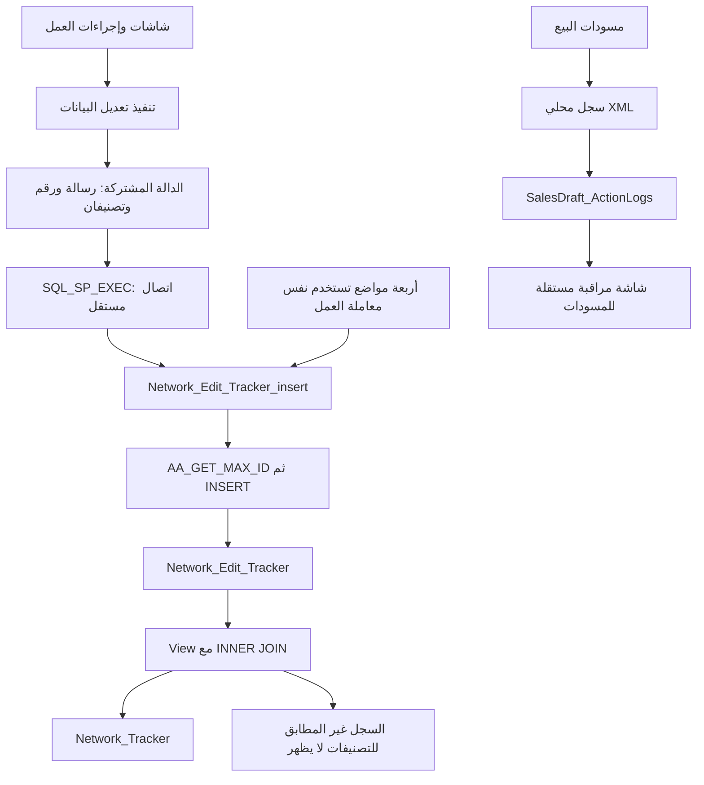
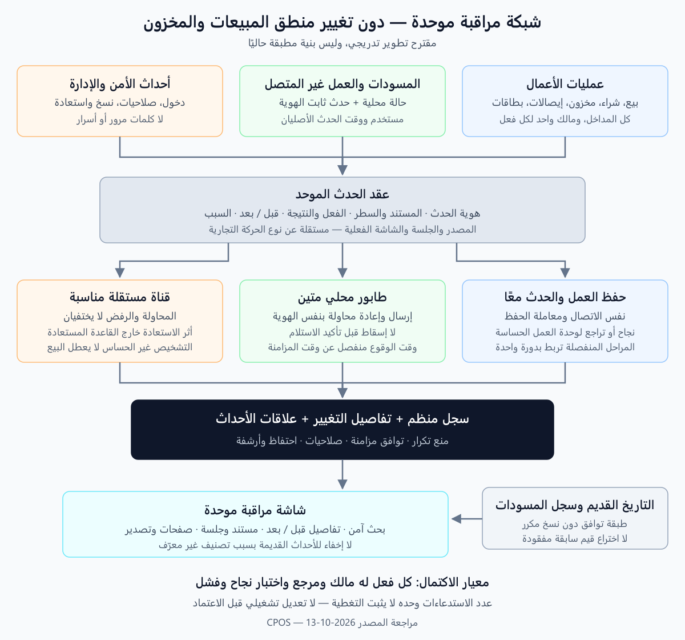

# مراجعة شبكة المراقبة في CPOS وخطة استكمالها

تاريخ المراجعة: 2026-10-13. الحالة: **تحليل وتوصيات، وليست تعديلات تشغيلية منفذة**.

**تحديث لاحق في اليوم نفسه:** هذا المستند محفوظ بوصفه خط أساس قبل الإصلاح. بدأت مطابقة القاعدة الحية وإصلاحات المرحلة الأولى بعد اعتماد المستخدم. الأعداد والملاحظات أدناه تصف الحالة السابقة، ما لم يذكر خلاف ذلك؛ راجع [تقرير التنفيذ الحالي](Phase0_Phase1_Result_AR.md) و[سجل التغطية](Coverage_Register_AR.md) لمعرفة ما أُصلح وما بقي مفتوحًا.

**تحديث نطاق التنفيذ بقرار المستخدم:** تحسين المسودات والعمل دون اتصال ودمج سجلهما مؤجل إلى مراحل متقدمة مستقلة. تبقى نتائج مراجعتهما هنا مرجعًا للمستقبل، لا أعمالًا مطلوبة في المرحلة الحالية. الخطة المحدثة في [Implementation_Plan_AR.md](Implementation_Plan_AR.md) هي مرجع ترتيب التنفيذ؛ لا تُعدل آلية المسودات الحالية، مع اختبار عدم تأثرها بأي تغيير مشترك.

## 1. النتيجة التنفيذية

شبكة المراقبة الحالية تسجل جانبًا مهمًا من تعديلات النظام، لكنها لا تكفي حاليًا كسجل تدقيق متكامل يمكن الاعتماد عليه لإثبات دورة كل معاملة. القصور ليس مجرد نسيان استدعاء الدالة في بعض الأزرار؛ توجد خمس مشكلات مستقلة:

1. عمليات لم نجد لها تسجيلًا في المسارات التي فُحصت.
2. أحداث تُحفظ بتصنيفات غير صحيحة أو غير معرّفة، وقد لا تظهر في شاشة المراقبة.
3. أحداث تسجل قبل تنفيذ العملية، وأحداث أخرى في اتصال منفصل بعد حفظ العملية، دون ضمان اتساق التسجيل معها.
4. رسائل لا تميز بين فتح التعديل وحفظه، ولا توضح القيم السابقة واللاحقة أو هوية المعاملة بدقة.
5. سجل مستقل للمسودات لا تعرضه شبكة المراقبة الحالية.

**التوصية:** إصلاح مواضع الخلل المؤكدة أولًا، ثم إنشاء عقد موحد للأحداث وطبقة تسجيل قابلة للاستخدام من الشاشات والإجراءات المشتركة. تُنفذ التوسعة بصورة إضافية وتدريجية، مع الإبقاء على البيانات القديمة وتوافق الاستدعاءات الحالية. لا نوصي باستبدال شامل دفعة واحدة، ولا بإضافة استدعاء عشوائي إلى كل زر.

## 2. النطاق والمصادر وحدود التحقق

المشروع الرسمي: `H:\DESKTOP SYSTEMS\Git Projects\CPOS`.

شملت المراجعة:

- حصر جميع المواضع النصية للدالة في ملفات VB الخاصة بتطبيق `resturant`، ومطابقتها مع ملف المشروع.
- مراجعة الدالة المشتركة، شاشة العرض، الرسائل، ومسارات العمل المرتبطة بالمبيعات والمشتريات والجرد والتالف والتسويات والأصناف وبقية المجالات المدرجة أدناه.
- البحث عن الكتّاب الآخرين في ملفات SQL/C# المتاحة بالمشروع، ومراجعة المسار المستقل لسجل المسودات.
- قراءة تعريفات الجدول والـView والإجراءات والمزامنة في `CPOS_ACCOUNTING.sql`؛ هذه **نسخة مصدر قديمة مؤرخة في رؤوس السكربت 09/05/2026**، وليست إثباتًا لتعريفات القاعدة المتصلة حاليًا.

لم تُنفذ استعلامات على القاعدة الفعلية، ولم تُجرّب عمليات بيع أو حذف أو استعادة. كذلك لم تجر مراجعة مستقلة شاملة لنظام `Accounting` الداخلي؛ الربط محل هذا التقرير هو شبكة مراقبة تطبيق المبيعات `resturant`. لا يمكن إعطاء نسبة تغطية تنفيذية أو ضمان «لا يوجد أي نقص» من الحصر النصي وحده؛ يلزم اختبار مصفوفة العمليات والقاعدة الحالية.

### نتائج الحصر

| النوع | العدد | المعنى |
|---|---:|---|
| استدعاءات الدالة المعتادة غير المعلقة | 144 | مواضع في المصدر، وقد تكون مشروطة أو غير قابلة للوصول عمليًا |
| استدعاءات الإجراء مباشرة داخل معاملات SQL | 4 | في المبيعات والمشتريات والإيصالات |
| مجموع مواضع الاستدعاء غير المعلقة | 148 | موزعة على 60 ملفًا، كلها مدرجة في مشروع VB |
| مواضع معلقة | 34 | لا تنفذ، ولا تدخل في حساب التغطية |
| تعريف الدالة ونص أمرها الداخلي | 2 | ليسا عمليتين تجاريتين إضافيتين |

الحصر المفصل، بكل ملف وسطر والإجراء الحاوي ونص الاستدعاء، موجود في [CallSites.md](CallSites.md). النسخة القابلة للمعالجة الآلية في [CallSites.json](CallSites.json)، وأداة إعادة توليدهما في [Build_Inventory.ps1](Build_Inventory.ps1).

أرقام الأسطر تخص نسخة المصدر عند المراجعة. المسارات المختصرة التالية تبدأ من `resturant`، ما لم يُذكر ملف قاعدة البيانات صراحة.

## 3. كيف تعمل المنظومة الحالية؟



يوضح المخطط المسار الغالب؛ بعض المواضع تسجل **قبل** العملية بدلًا من بعدها.

### الدالة والاتصال

`Modules/FunModule.vb:1540` تستقبل:

```vb
Network_Edit_Tracker_insert(Notes As String,
                           Bill_ID As String,
                           Screen_Type As Integer,
                           Operation_ID As Integer)
```

تأخذ المستخدم من `USER_ID` العام والجهاز من `My.Computer.Name`. لا تستقبل هوية السطر أو معرف الحركة الداخلي أو النتيجة أو القيم السابقة، ولا تعيد معرف الحدث أو نتيجة تسجيل واضحة.

`SQL_SP_EXEC` في `FunModule.vb:682` ينشئ اتصالًا جديدًا ويضعه على الأمر. لذلك لا يصلح استخدامه كما هو لإلحاق الحدث بمعاملة SQL مفتوحة يملكها المستدعي. كما أن تفسير نجاح العملية اعتمادًا على عدد الصفوف من `ExecuteNonQuery` ليس عقد نجاح صريحًا لكل الإجراءات؛ يجب تصميم نتيجة محددة للطبقة الجديدة، دون تغيير هذا المساعد العام على مستوى المشروع عشوائيًا.

### الجدول في نسخة SQL

المصدر: `CPOS_ACCOUNTING.sql:2377`.

| الحقل | النوع الحالي | الملاحظة |
|---|---|---|
| T_ID | int، مفتاح أساسي، ليس Identity | الترقيم من الإجراء المشترك |
| User_ID | int NOT NULL | لا يدعم مستخدمًا مجهولًا في فشل الدخول دون تصميم إضافي |
| Date | datetime NOT NULL | وقت الإدراج بالخادم عبر GETDATE، لا وقت وقوع الحدث غير المتصل |
| Screen_Type | int NULL | مرتبط بأنواع المعاملات وليس سجل شاشات مستقلًا |
| Operation_ID | int NULL | الأنواع الموجودة في النسخة: إضافة، حذف، تعديل |
| Notes | nvarchar(max) NULL | يحمل معظم المعنى كنص حر |
| Bill_ID | nvarchar(50) NULL | يستخدم لأرقام مستندات وأصناف وأصفار وقيم مالية، بمعانٍ مختلفة |
| CP_Name | nvarchar(600) NULL | اسم الجهاز وليس معرف مصدر فريدًا للمزامنة |

الإجراء عند `CPOS_ACCOUNTING.sql:40999` يستدعي `AA_GET_MAX_ID` ثم يدرج الصف. المولّد عند `15512` يعتمد على `MAX + 1` ضمن مدى `SERVERS`. لا يظهر في تعريفه قفل تخصيص يحمي القراءة والإدراج معًا؛ لذلك يوجد **خطر تصادم عند التزامن**، وليس إثباتًا أن تصادمًا وقع بالفعل. لا يُستبدل المولّد المشترك أو نظام المديات قبل تحليل المزامنة وبقية مستخدميه.

## 4. النتائج المؤكدة ومواقعها

ترتيب الأولوية هنا: **عالية** = قد يخفي أو يفقد دليلًا أو يصف نتيجة غير صحيحة؛ **متوسطة** = يضعف التفسير والبحث والمتابعة.

### 4.1 أحداث محفوظة لكنها مخفية أو تحت تصنيف خاطئ

| الأولوية | الموقع | النتيجة والإجراء المطلوب لاحقًا |
|---|---|---|
| عالية | `CPOS_ACCOUNTING.sql:9425` | الـView يستخدم INNER JOIN مع المستخدمين والأنواع والعمليات؛ أي مرجع غير موجود يستبعد الحدث. يلزم عرض متسامح مع المراجع القديمة وتسميات «غير معرّف»، دون قبول بيانات جديدة معيبة بصمت. |
| عالية | `Forms/POS/POS.vb:3388` | فتح التعديل يمرر الصافي كـBill_ID ويمرر 0،0 للتصنيف والعملية؛ النص يقول «تعديل» رغم أنه دخول وضع التعديل. |
| عالية | `Forms/Stores/IM_Execute.vb:683` و`Invoice.vb:1861` | نفس نمط الإجمالي بدل المرجع، مع 0،0 في التالف والجرد. |
| عالية | `Forms/Stores/ST_settlement.vb:897` | يمرر كمية الزيادة كرقم المستند، مع 0،0، ويسمي التسوية «جردًا». |
| عالية | `Forms/Stores/Outside_Sales.vb:328` | الإجمالي بدل المرجع، 0،0، ووصف «فاتورة داخلية» في شاشة إذن الاستلام. |
| عالية | `Forms/POS/OrdersMenu.vb:869` | استعادة وضع الطلبية تستخدم قيمة الصافي كمرجع و0،0؛ يصعب العثور عليها بالطلبية. |
| عالية | `Forms/Sys_Options/Recount_IM_Cost.vb:66` | رقم الصنف يوضع مكان Screen_Type وOperation_ID=0؛ يجب فصل هوية الصنف عن نوع العملية. |
| عالية | `Forms/Stores/ST_settlement.vb:488` | إلغاء التسوية يصنف 9 «الجرد»، بينما حذف سطرها عند 663 يصنف 39 «التسوية». |
| عالية | `Forms/Stores/Outside_Sales.vb:370` | إلغاء إذن الاستلام يصنف 17 «إذن الصرف» بدل 35 «الاستلام» وفق تعريفات النسخة. |
| متوسطة | `Forms/Stores/Outside_Sales_Touch.vb:713` | تعديل الكمية يسجل عملية 1 «إضافة» بدل تعديل. |
| متوسطة | `Forms/POS/ViewBill.vb:1204` | تغيير عميل عرض السعر يصنف 1 «مبيعات» بدل 16 «عرض سعر». |
| عالية | `Forms/Sys_Options/Backup.vb:82` | حدث الاستعادة 0،0. يحتاج تصنيف إدارة النظام ومرجع مهمة استعادة، لا رقم فاتورة وهميًا. |

التصنيف 39 موجود أصلًا للتسويات في نسخة القاعدة؛ لذلك مشكلة `ST_settlement` ليست مجرد إضافة اسم للشاشة. المشكلة في عدم اتساق مسارات التسجيل وربطها بالمستند.

### 4.2 اتساق الحدث مع العملية

| الموقع | المشكلة |
|---|---|
| `Forms/Tables/TB_BillIM.vb:13,22,30` | التسجيل يسبق `Change_IM_Qty` أو `SB_Contents_Delete_IM`. عند رفض العملية أو فشلها يبقى سجل لا يوضح أنها لم تنجح. حذف السطر أيضًا مصنف كتعديل. |
| `Forms/Stores/Outside_Sales_Touch.vb:706–717` | تُعتمد معاملة تعديل الكمية ثم تُستدعى المراقبة. فشل التسجيل يدخل مسار الخطأ بعد أن تغيرت الكمية فعلًا. يجب ألا تدفع رسالة فشل غامضة المستخدم إلى إعادة التعديل. |
| معظم الاستدعاءات عبر `FunModule` | عملية العمل والتسجيل ليستا ذريتين. يمكن نجاح العمل وفشل التسجيل، أو تأخر التسجيل وتغير بيانات الواجهة المستخدمة في الرسالة. |
| `Forms/Stores/STORES_Explorer.vb:967,972,994,999` | لكل إعادة حساب كمية/تكلفة استدعاءان؛ أحدهما 0،0 والآخر 23،3. هذا تكرار لنفس التشغيل، لا مرحلتان واضحتان من بداية ونجاح. |
| `Forms/POS/Sales.vb:1763–1786` | يسجل داخل معاملة الحفظ حدثًا عن الخصم، ثم Commit، ثم تسوية المدفوعات خارج تلك المعاملة. حدث الخصم لا يثبت نجاح دورة تعديل الفاتورة وتسوية دفعاتها بالكامل. |

توجد أمثلة جيدة جزئيًا يمكن البناء عليها: `Pch.vb:682,877` و`Sales.vb:1763` و`Receipt.vb:517` تستدعي الإجراء باستخدام نفس الاتصال والمعاملة. لا تحتاج إلى «إضافة استدعاء ثانٍ»، بل إلى تحسين العقد والبيانات المرسلة والتغطية المحيطة بها.

في العمليات متعددة المراحل التي يُحفظ بعضها مباشرة، لا يجوز اختراع ذرية غير موجودة. نسجل كل تغيير ملتزم به فعلًا، ونربطه بمعرف دورة واحد، ثم نسجل إتمام الدورة أو عدم اكتمالها. فشل تسوية الدفع لا يحول التعديل الذي حُفظ سابقًا إلى عملية لم تحدث.

### 4.3 مراجع ناقصة ورسائل ملتبسة

- `Bill_ID` يساوي صفرًا في كثير من بطاقات العملاء والمستخدمين والوحدات والتصنيفات والأرصدة والتحويلات. لا يكفي الاسم لربط التاريخ بالكيان بعد تغيير اسمه.
- يجب حفظ `T_ID` الداخلي للمستند و`Line_T_ID` للسطر بجانب رقم المستند الظاهر؛ أرقام العرض قد تتكرر بين أنواع العمليات أو الفروع أو السنوات.
- في `Forms/Change_IM_Details.vb:713` تُكتب قيمة `PriceTextBox` تحت التكلفة وتحت سعر البيع، مع أن أمر الحفظ يرسل سعر البيع من `NewSalePrice_txt` عند 707. هذه رسالة تحمل قيمة غير مطابقة للحقل المقصود.
- في `Forms/Stores/IM_Update_Qty.vb:96` يسجل الحدث بتصنيف التسوية الصحيح 39، لكن دون مرجع المستند؛ الرسالة لا تميز بوضوح بين الرصيد السابق والجديد والفرق. كما تعرض تكلفة بينما إرسال `@Cost` معلق عند 87؛ يجب عدم صياغتها باعتبار التكلفة قد تغيرت بهذا الأمر.
- إلغاء الفواتير والإيصالات يظهر أحيانًا «تعديلًا» وأحيانًا «حذفًا». الإلغاء المنطقي والحذف الفعلي عمليتان مختلفتان.
- أكثر الرسائل تعرض القيم الحالية فقط: «الصنف… العدد… السعر…». لا تثبت ما الذي تغير، ولا من كم إلى كم، ولا السبب أو المخزن أو السطر.
- `FunModule.vb:1371` في إجراء مشترك يأخذ مرجع الإيصال من `F_Receipt` العام بدل الاعتماد على المعاملة الممررة وحدها؛ يلزم فك هذا الارتباط عند إعادة التصميم.
- النصوص التفصيلية لبطاقة العميل تحتوي معلومات اتصال وعنوان. عرضها وتصديرها يحتاج صلاحية واحتفاظًا مدروسًا، لا توسيع كمية البيانات الشخصية دون حاجة.

**تصحيح مهم لمنع إصلاحات خاطئة:** `QtyTextBox` في `Sales_Fast.vb:56` متغير `Double` وليس أداة TextBox؛ استخدام `.ToString()` عند 1229 ليس خطأ من نوع طباعة اسم الأداة. كذلك استدعاء الخصم في `SBChangePrice.vb:29` صحيح في فرع الخصم؛ النقص الحقيقي أن فرع تغيير السعر `IM_Conferm_NewPrice` عند 94–111 لا يحتوي حدثًا مماثلًا في هذا المسار.

## 5. مصفوفة التغطية بحسب مجال العمل

«جزئية» تعني وجود تسجيلات، لا اكتمال دورة المجال. «لم نجد» تصف المصدر المفحوص؛ إجراءات أو Triggers مضافة إلى القاعدة الحية قد تغير النتيجة، ويجب التحقق منها.

| المجال/الشاشات | الموجود | النقص أو العمل المطلوب |
|---|---|---|
| `Sales`, `POS`, `Sales_Fast` | أصناف، كميات، حذف، إلغاء، بعض الخصم وتغيير العميل | إنشاء/اعتماد نهائي واضح؛ فتح تعديل منفصل عن حفظه؛ رأس الفاتورة؛ ربط الدفع والتسوية؛ أسباب الإلغاء؛ تمييز الشاشة الفعلية من نوع «مبيعات» |
| `SB_IM_card`, `Change_IM_Details`, `Fast_SB_Discount`, `SBChangePrice` | تسجيلات من نوافذ فرعية | توحيد مصدر الحدث ومنع تسجيله مرتين في الأب والنافذة؛ تسجيل تغيير سعر POS؛ قبل/بعد ومعرف السطر |
| `Sales_Fast_Draft` | سجل مستقل غني نسبيًا: وقت، مستخدم، جهاز، قبل/بعد، صنف، مسودة، وربط بالفاتورة النهائية | دمجه منطقيًا في البحث، مع منع التكرار وتأمين الصف المحلي والتحقق من تسليم الدفعات؛ ليس شاشة بلا مراقبة |
| الدفع: `Pay_Main_Form`, `SalesPaymentSqlLayer`, `SalesBillPaymentEditService` | الإيصال اليدوي له تسجيل، لكن لم نجد استدعاء الشبكة في طبقات الدفع المذكورة أو سكربتات V2 المفحوصة | حدث لكل تحصيل/صرف ناجح وربطه بالفاتورة والتسوية؛ إجمالي قبل/بعد وقائمة الإيصالات والخزائن؛ لا نسجل مجرد فتح نافذة الدفع كتحصيل |
| `Pch`, `Pch_IM_card_11` | أصناف، حذف، إلغاء، حساب، خصم، وبعض الحفظ الذري | اكتمال الاعتماد ورأس الفاتورة والتغييرات الفعلية؛ استبدال رسالة «خصم» وحدها عند تعديل حقول أخرى |
| `Returns` | إضافة/حذف بنود بنوعي راجع المبيعات والمشتريات | اعتماد المرتجع، مصدر كل سطر، العملية النقدية المرتبطة، الإلغاء والرفض؛ لا يكفي عرض مدفوعات الأصل لإثبات تسديد المرتجع |
| `Invoice`, `Invoice_IM_card` | إضافة وحذف جرد وإلغاء | تصحيح فتح التعديل، اعتماد الجرد، فروق المخزون قبل/بعد ونطاق المخزن |
| `IM_Execute`, `IMEX_IM_card` | بنود التالف، حذف، إلغاء | تصحيح التصنيف/المرجع عند التعديل؛ اعتماد التالف والسبب والكميات والتكلفة المثبتة |
| `ST_settlement`, `ST_settlement_IM_card`, `IM_Update_Qty` | حذف السطر 39؛ تعديل الرصيد عبر النافذة المشتركة 39؛ إلغاء مصنف 9 | تصحيح الإلغاء وفتح التعديل؛ مرجع التسوية عند تعديل الكمية؛ سابق/جديد/فرق؛ إنشاء واعتماد الرأس والأسباب |
| `Outside_Sales`, `Outside_Sales_Touch`, `Outside_Sales_IM_card` | إضافة/حذف أصناف؛ تعديل كمية في اللمس | تصحيح إلغاء العادية؛ إضافة أحداث الاعتماد والإلغاء وفتح التعديل وحفظ الرأس في اللمسية؛ تصحيح عملية تعديل الكمية |
| `Inside_Sales`, `Inside_Sales_IM_card` | أصناف وحذف وإلغاء إذن صرف | استكمال دورة الاعتماد والتعديل وربط المخزن/الحساب |
| `Stores_ImmediateOrder`, `Stores_Trans_IM_card` | إضافة وحذف بنود تحويل | حدث تحويل معتمد من مخزن إلى مخزن، وحالة الإلغاء/التعديل ومرجع موحد لطرفيه |
| `ItemsMenu`, `IM_ADD_New`, `IM_Fast_Mang`, `Update_IM_Unit` | إنشاء/تعديل/حذف، وحدات، بعض السعر السابق | توحيد هوية الصنف والوحدة والباركود؛ حفظ تغييرات الحقول لا إعادة نسخ البطاقة كاملة؛ تغطية كل مدخل سريع |
| `GeneralMenu`, `Units` | إضافة/تعديل/حذف | معرفات ثابتة، قبل/بعد، ارتباط التغيير بالأصناف المتأثرة عند الحاجة |
| الأسعار والعروض: `IM_Change_Price_ByPercent`, `IM_Change_PriceByVal`, `OFFERS` | تسجيلات جماعية أو تفصيلية جزئية | معرف تشغيل للتعديل الجماعي، المرشح المستخدم، عدد الصفوف، قيم قبل/بعد، والإخفاق الجزئي إن كان ممكنًا |
| `STORES_Explorer`, `IM_CYRCLE`, `Recount_IM_Cost` | إعادة حساب كميات وتكلفة | إزالة التكرار، تصحيح المعرفات، حدث بدء/نتيجة منفصل للعمليات الطويلة، نطاق تاريخ ومخزن وصنف |
| `Agent`, `AgentsMenu`, الإضافة السريعة للعملاء | بطاقة وتغيير عميل المعاملة | معرف العميل/المورد/الموظف، القديم والجديد، نتيجة الربط بالدليل عند تشغيل البوابة المحاسبية |
| `STORES`, `Tr_Card`, `EXP_Card` | توجد إجراءات إنشاء/تعديل/حذف فعلية، دون استدعاءات للشبكة في الملفات | إضافة أحداث بطاقات المخازن والخزائن/المصارف وبنود المصروف؛ تسجيل الربط المحاسبي أو كونه غير مطلوب عند إيقاف البوابة |
| `EXP_Details`, `Custody`, `Add_Prev_Balance`, `Emp_OtherValues`, الرواتب في `Balances` | تسجيلات بنود/حركات/إلغاء | ربط الرأس والتفاصيل والكيان، مرجع الدفعة للرواتب، بيان الإلغاء لا الحذف، وتغطية الاعتماد |
| `Receipt`, `Tr_Deposit_Withdraw`, `Tr_Transfers`, `AG_Transfers` | إنشاء/إلغاء؛ تعديل الإيصال بمعاملة واحدة | اتجاه قبض/صرف، الحسابان، الخزينة، العملة والمبلغ والخصم والمرجع؛ ربط القيود/السندات الناتجة دون تكرار |
| `ViewBill`, `ViewBill_IM_card` | بنود وخصم وعميل | تصحيح تصنيف العميل إلى عرض سعر، وتغطية التحويل من العرض إلى فاتورة |
| `TablesBalance`, `Tables_Trans_IM`, `TB_BillIM`, `OrdersMenu`, `POS_Abcent_Bills` | نقل طاولات/أصناف وإلغاء وبعض الكميات | قبل/بعد التنفيذ، معرفا الطاولتين والفواتير، حالة الطلبية، منع وصف محاولة فاشلة كتغيير ناجح |
| التصنيع والوصفات: `Format_Items_Auto`, `Format_Items_Manual` ونوافذهما | بعض الإضافات والحذف للمنتج/المكونات/الخدمات | اعتماد التشغيل، مدخلات ومخرجات وتكلفة، سبب الإلغاء، قبل/بعد للوصفة، وتصحيح رسالة سعر البيع |
| `Users`, `User_Valids`, `UpdateUserPass` | بطاقة المستخدم مسجلة؛ تعديلات الصلاحيات وكلمة المرور بلا استدعاء مباشر للشبكة | تسجيل منح/سحب صلاحية وتغيير كلمة مرور **دون حفظ الكلمة أو مشتقاتها**؛ معرف المنفذ والهدف منفصلان |
| `login`, إغلاق/خروج `MainForm` | لم نجد أحداث دخول/رفض/خروج في المسارات المفحوصة | جلسة، نجاح/رفض/فشل دخول، خروج صريح وانتهاء جلسة؛ لا تعتبر انهيار التطبيق خروجًا ناجحًا |
| الورديات والإعدادات والنسخ | غلق الورديات يحتاج تعقب مساره المشترك؛ الاستعادة لها استدعاء 0،0؛ سجلات الجدولة التشغيلية ليست سجل تدقيق موحدًا | فتح/إغلاق وردية وسبب الرفض، تغيير الإعدادات والجدولة، بدء/نتيجة نسخ واستعادة، وتصدير سجل المراقبة |
| `CPOS.PosApi` | يوجد دخول وقراءة كتالوج، ولا وجدنا كاتبًا للشبكة في C# | ربط هوية/جلسة المصدر إذا أُدرج هذا المدخل في النطاق؛ لا يُعد Console/Debug logging بديلًا لسجل تدقيق العمليات |

مواضع البطاقات غير المغطاة مباشرة: `STORES.vb:31,106,219`، `Tr_Card.vb:86,101,116`، `EXP_Card.vb:24,81,148`. مواضع الصلاحيات: `User_Valids.vb:53,154,314`؛ كلمة المرور `UpdateUserPass.vb:64`.

### التسويات: المسار الذي لا ينبغي إغفاله

`ST_settlement_IM_card.vb:145` يفتح `IM_Update_Qty`؛ التسجيل موجود فعلًا في الأخيرة عند 96. إذن لا نضيف حدثًا ثانيًا إلى نافذة اختيار الصنف. نصلح الحدث في نقطة نجاح تعديل الرصيد، ونمرر إليه هوية التسوية ونوع التغيير بدقة.

### الدخول: هوية المنفذ ليست دائمًا USER_ID

في `login.vb:564–653` يتم تعيين المستخدم العام قبل فحص السماح بالدخول في 579. عند فشل كلمة المرور قد لا يوجد مستخدم معروف أصلًا. لذلك:

- نجاح الدخول يسجل بعد التحقق من السماح وبدء الجلسة، لا بمجرد العثور على صف المستخدم.
- الفشل يسجل مجهول الهوية إن لم تثبت هوية المستخدم؛ لا ينسب للمستخدم السابق الموجود بالمتغير العام.
- الرفض لمستخدم معروف يفرق عن محاولة مجهولة، مع سبب مصنف لا تفاصيل حساسة.
- لا تسجل كلمة المرور أو النص المشفر أو token أو connection string، ولا حتى ضمن رسالة خطأ خام.
- لمسارات الدخول الإداري/الصيانة حدث مستقل وفق صلاحيتها، دون توثيق أسرار الوصول في السجل.

## 6. شاشة Network_Tracker نفسها تحتاج تحسينًا

1. مصدر قائمة «الشاشات» عند `Network_Tracker.vb:67` هو `AgentBalance_Type`. هذا يخلط نوع المعاملة بواجهة التنفيذ؛ «مبيعات» لا يحدد Sales أم POS أم Sales_Fast، ولا يغطي login طبيعيًا.
2. الاستعلام عند 145–155 مبني بدمج نصوص. `Bill_ID` نصي في الجدول لكن مرشحه يوضع دون باراميتر أو علامات نص؛ البحث برقم/مرجع غير رقمي معرض لأخطاء تحويل، والنص غير الموثوق يفتح خطر حقن SQL. إدخال المستخدم يجب أن يمر عبر معاملات typed parameters.
3. التاريخ من `.Text` ويتأثر بتنسيق الجهاز. المطلوب `DateTime` كمعاملين وحدود `Date >= @From AND Date < @ToExclusive`، مع فهرس مناسب بعد قياس الاستخدام.
4. `ORDER BY Date` وحده لا يحسم ترتيب الأحداث المتساوية في الوقت. القديم: `Date,T_ID`؛ الجديد: وقت الحدث ثم مفتاح ترتيب ثابت مع إظهار وقت الاستلام أيضًا. لا يُفسر ترتيب المعرّفات كترتيب زمني بين أجهزة غير متصلة.
5. `IM_DT.Clear()` عند 143 يزيل نتيجة البحث السابقة قبل نجاح الجديد. المطلوب تعبئة جدول مؤقت ثم استبداله بعد النجاح.
6. `RowFilter` عند 206 لا يهرب المحارف الخاصة؛ يجب معالجة `'`, `[`, `]`, `%`, `*` حسب تعبيرات DataView، أو نقل البحث إلى استعلام آمن.
7. لا توجد صفحات نتائج؛ التحميل المتزامن بمهلة 120 ثانية قد يجمد الشاشة. المطلوب paging وتحميل قابل للإلغاء وحالة واضحة، مع تطبيق نفس المرشحات على العدد والتصدير.
8. الأعمدة المخفية مرتبطة بأرقام مواضع عند 178–181؛ عند التوسعة تعتمد الأسماء. يضاف عرض تفاصيل الحدث وجدول «قبل/بعد» وربط بالمستند إن بقي موجودًا.
9. توحيد العرض لا يعني نسخ كل سجل مسودة إلى القديم. يلزم مصدر موحد مع `SourceSystem + EventId/LegacyKey`، وتمييز سجل الأعمال عن تشخيص الأزرار والطباعة.

## 7. المسودات والمزامنة والاحتفاظ

### المسودات ليست بلا سجل

في `Sales_Fast_Draft.vb:767` يبنى جدول سجل محلي، و`AddDraftLog` عند 1021 يحتفظ بوقت الحدث والمستخدم والجهاز وقيم قبل/بعد. يحفظ غير المرسل في XML، ثم يرسل عبر TVP إلى `SalesDraft_ActionLogs_InsertBatch` عند 1375. الشاشة `FrmSalesDraftActionLogMonitor` تقرأ `SalesDraft_ActionLogs`، لا جدول الشبكة القديم.

لم نجد تعريف إجراء الإدراج الخاص بهذا السجل ضمن سكربتات SQL المفحوصة؛ لذلك **لا نجزم** أنه يمنع التكرار في الخادم. توجد نافذة خطر يجب اختبارها: نجاح إرسال الدفعة ثم انقطاع التطبيق قبل حفظ علامة `IsSynced` محليًا. رقم محلي متسلسل واسم جهاز وحدهما ليسا بديلًا مضمونًا لمعرف حدث ثابت عالميًا.

المطلوب الإبقاء على العمل دون اتصال، وحفظ الحدث محليًا بشكل متين، وإعادة إرساله بنفس `EventId`، مع قيد فريد في جهة الاستقبال. وقت حدوثه لا يستبدل بوقت المزامنة. الأحداث التشغيلية مثل الضغط على زر تصنيف لا تغمر السجل المالي الافتراضي.

### المزامنة ليست حدث بيع جديدًا

`CPOS_ACCOUNTING.sql:14011` يضم `Network_Edit_Tracker` في `SYNCRO_TABLE` للإرسال والاستقبال، مع قائمة أعمدة صريحة. كل إضافة بنيوية يجب أن تراعي توافق المخطط والمزامنة. لا يعاد إنشاء حدث العمل عند إعادة تطبيق نفس الحدث المتزامن، ولا يستخدم اسم الجهاز كمفتاح فرع موثوق.

### الاحتفاظ والأرشفة

- الإجراء `REDUCE_NETWORK_TRACKER` عند `CPOS_ACCOUNTING.sql:47826` يحذف 25,000 صف عندما يتجاوز العدد 50,000، بلا ترتيب صريح؛ لا يضمن حذف الأقدم. استدعاؤه في `MainForm.vb:714` **معلق حاليًا**؛ لا ندعي أنه ينفذ عند كل إغلاق.
- `DeleteAll_BuysAndSales` يحتوي حذفًا للشبكة عند 28874. يلزم قرار صريح بشأن الاحتفاظ بدليل تنفيذ التصفير خارج البيانات المصفرة.
- استعادة قاعدة قديمة تستبدل سجل المراقبة داخلها أيضًا. سجل داخل نفس القاعدة وحده لا يستطيع إثبات كل عمليات الاستعادة أو الحذف الإداري؛ يحتاج أثرًا إداريًا مستقلًا/مركزيًا حسب السياسة المعتمدة.
- لا يحذف السجل حسب العدد وحده. تعتمد مدة وسبب وصلاحية وأرشيف قابل للتحقق، مع حدث للعملية الإدارية. السجل ليس حصينًا ضد مدير قاعدة البيانات لمجرد منعه من واجهة المستخدم.

## 8. الشكل المستهدف

الرسم المستقل في [Network_Tracker_Architecture.svg](Network_Tracker_Architecture.svg)، وتفاصيل التنفيذ في [Implementation_Plan_AR.md](Implementation_Plan_AR.md).

المخطط التالي يمثل الرؤية الكاملة على المدى الطويل؛ مسار المسودات والطابور المحلي ودمج سجل المسودات فيه **مؤجل وخارج نطاق التنفيذ الحالي**. المرحلة الحالية لا تعتمد على إنجازه.



### القاعدة الحاكمة

**نسجل التغيير عند نقطة حفظه الحقيقية، ببيانات منظمة وهوية ثابتة؛ ثم نصوغ الرسالة العربية من تلك البيانات.** لا تكون صياغة الرسالة هي المصدر الوحيد للحقيقة.

أنواع المعلومات منفصلة:

- `ScreenCode`: الواجهة الفعلية، مثل `POS` أو `Sales_Fast` أو `login`.
- `EntityType` و`DocumentType`: صنف/مستند/مستخدم ونوع المعاملة التجاري.
- `ActionCode`: إنشاء، إضافة سطر، تعديل كمية، تغيير سعر، اعتماد، فتح تعديل، إلغاء، حذف، دخول، رفض، استعادة…
- `Outcome`: نجاح، رفض، فشل، بدء، أو غير مكتمل. ليست كلها عمليات مالية، ولا تعرض كأحداث نجاح متشابهة.
- `EntityId`, `DocumentId`, `DocumentNumber`, `LineId`, `RelatedIds`: مرجع ثابت مع رقم العرض والعلاقات.
- `Actor`, `TargetUser`, `Session`, `Source`, الوقت والقيم السابقة/اللاحقة والسبب.

لا يضاف login كنوع حركة مالية داخل `AgentBalance_Type` لمجرد إظهاره في قائمة المراقبة. نحتاج سجل شاشات/أفعال مستقلًا مع خريطة توافق للتاريخ القديم.

### اقتراح بنية إضافية للنقاش، وليس DDL معتمدًا

| الجزء المقترح | بياناته الأساسية |
|---|---|
| `AuditScreens` و`AuditActions` | رموز ثابتة قابلة للقراءة، عنوان عربي، فئة العمل، حالة التفعيل |
| `AuditEvents` | `EventId uniqueidentifier` فريد، مفتاح ترتيب محلي، `CorrelationId`، المصدر/الفرع، ActorUserId قابل لـNULL، نسخة اسم المستخدم، الجلسة، كود الشاشة والفعل والنتيجة، الهوية التجارية، السبب، وقت الوقوع ووقت الاستلام |
| `AuditEventChanges` | حقول التغيير وأسماء الحقول وأنواعها، قيم قبل/بعد، ومرجع سطر أو كيان تابع عند الحاجة |
| `AuditEventLinks` عند الحاجة | الفاتورة، إيصالات القبض/الصرف، حركة المخزون، أصل المرتجع، تشغيل جماعي؛ دون حشر العلاقات في Notes |
| Outbox محلي للمسودات/الأحداث غير المتصلة | نفس EventId والحمولة الثابتة، حالة الإرسال، عدد المحاولات وآخر خطأ تقني منزوع الحساسية |

تفاصيل الأنواع النهائية تعتمد بعد جرد المفاتيح الحالية. المبالغ والكميات تنقل كـDecimal مطابق لأعمدة العمل، لا بتنسيق العرض `N3`. التواريخ الجديدة `datetime2` بمرجعية وقت موثقة؛ لا نحول التاريخ القديم إلى UTC بتخمين. `EventId` لا يغير أرقام الفواتير أو مفاتيح النظام الحالية.

التنفيذ متوافق مع SQL Server 2014: TVP أو XML/جداول تفاصيل للقيم المنظمة، دون اشتراط `OPENJSON` أو ميزات إصدار أحدث. تبقى `Notes` للعرض والبحث، مع `TemplateVersion` لحفظ معنى النص التاريخي. لا حاجة إلى مكتبة جديدة لمجرد البدء.

### من يملك تسجيل الحدث؟

لكل فعل مالك واحد عند أقرب نقطة مشتركة تحفظ العمل: إجراء SQL أو خدمة مشتركة، وليس كلًا منهما وكل زر في الوقت نفسه. نمرر سياق المستخدم والشاشة والجلسة صراحة. الشاشة تسجل محاولات الدخول/الرفض والتنقل المهمة فقط، بينما الإجراء الذي يغير البيانات يسجل النتيجة المعتمدة.

المقترح للعمليات الحساسة داخل قاعدة واحدة: تعديل البيانات وإدراج الحدث في **نفس الاتصال والمعاملة**؛ فشل الإدراج يفشل هذه الوحدة من العمل مع رسالة واضحة. لا يكتب الكاتب الداخلي Commit مستقلًا إذا كانت المعاملة ملك المستدعي. عمليات التشخيص غير الحساسة تسير بطابور منفصل ولا تعطل البيع. نجاح البيع غير المتصل يعتمد على حفظ الحالة المحلية والحدث محليًا وفق آلية متينة، لا على توفر السحابة.

إذا كانت النتيجة بعد انقطاع الاتصال غير معروفة، لا نكتب «فشل نهائي» ولا نعيد العمل عشوائيًا؛ يستعلم بمعرف الطلب/الحدث الثابت ثم يستكمل. لا يُسمح لخطأ التسجيل باستدعاء المسجل نفسه في حلقة.

## 9. معيار الرسائل العربية المقترح

الصيغة الأساسية: **الفعل الذي حدث + المرجع + الكيان + التغيير قبل/بعد + السياق اللازم + السبب إن كان مطلوبًا**. يظهر المستخدم والوقت والجهاز في أعمدة مستقلة، فلا حاجة لتكرارها داخل كل رسالة.

القيم التالية أمثلة توضيحية، وليست معاملات فعلية مستخرجة من بيانات المستخدم.

| الحدث | مثال الرسالة |
|---|---|
| إنشاء فاتورة | تم إنشاء فاتورة مبيعات رقم 152 كمسودة، للعميل «نقدي». |
| اعتماد الفاتورة | تم اعتماد فاتورة المبيعات رقم 152: الإجمالي 100.000، الخصم 5.000، الصافي 95.000. |
| إضافة سطر | أُضيف «حليب» إلى الفاتورة 152، السطر 804: الكمية 2.000 علبة، سعر الوحدة 5.000، المخزن «الرئيسي». |
| تغيير كمية | عُدلت كمية «حليب» في الفاتورة 152، السطر 804: من 2.000 إلى 3.000 علبة؛ إجمالي السطر من 10.000 إلى 15.000. |
| تغيير السعر/الخصم | عُدل سعر الوحدة للسطر 804 من 5.000 إلى 4.500؛ السبب: موافقة المدير. / عُدل خصم الفاتورة من 0.000 إلى 5.000. |
| تغيير العميل | نُقلت الفاتورة 152 من العميل «نقدي» إلى «العميل ب»، مع حفظ معرفَي العميلين. |
| فتح تعديل | فُتحت الفاتورة المعتمدة 152 للتعديل. لا يعني هذا أن بياناتها تغيرت أو أن تعديلها اعتمد. |
| إنهاء دورة التعديل | اكتمل حفظ تعديل الفاتورة 152 وتسوية المدفوعات المرتبطة بها. لا تستخدم العبارة قبل اكتمال المرحلتين. |
| تحصيل متعدد | تم تحصيل 60.000 نقدًا إلى الخزينة «الرئيسية» بالإيصال 91، و35.000 بالبطاقة إلى حساب «المصرف» بالإيصال 92، للفاتورة 152. تعرض التفاصيل كسطور منظمة. |
| صرف فرق | تم رد فرق 10.000 للفاتورة 152 بسند صرف 93 من الخزينة «الرئيسية»؛ صافي المحصل من 95.000 إلى 85.000. |
| حذف سطر | حُذف السطر 804 من الفاتورة 152: «حليب»، 3.000 علبة، بإجمالي 15.000؛ السبب: إدخال مكرر. |
| إلغاء مستند | أُلغيت فاتورة المبيعات 152؛ السبب: طلب العميل. تُربط نتائج إلغاء السندات والمخزون بأحداثها، ولا يدعى نجاحها دون تحقق. |
| تسوية مخزون | اعتُمدت التسوية 18 للصنف «حليب» في المخزن «الرئيسي»: الرصيد من 12.000 إلى 10.000، الفرق -2.000؛ السبب: فرق عد فعلي. |
| تالف | اعتُمد إذن التالف 8: «حليب»، كمية 2.000 علبة، من المخزن «الرئيسي»؛ السبب: انتهاء الصلاحية. |
| استلام/تحويل | اعتُمد إذن الاستلام 24، عدد البنود 3 وإجمالي الكمية 20.000. / اعتُمد التحويل 31 من «الرئيسي» إلى «الفرعي»؛ التفاصيل مرتبطة بالحدث. |
| إعادة حساب جماعية | اكتملت إعادة حساب تكلفة 120 صنفًا للفترة المحددة، تشغيل R؛ تعرض المعايير والنتائج التفصيلية ضمن التشغيل. |
| دخول/رفض | نجح تسجيل الدخول وبدأت جلسة جديدة. / رُفض تسجيل الدخول: المستخدم غير مسموح له. / فشلت محاولة دخول مجهولة؛ دون حفظ كلمة المرور. |
| صلاحيات | سُحبت صلاحية «إلغاء فاتورة» من المجموعة «الكاشير»؛ المنفذ والهدف وقبل/بعد محفوظة. |
| تغيير كلمة مرور | تم تغيير كلمة مرور المستخدم 7 بواسطة المستخدم 1. لا تحفظ الكلمة القديمة أو الجديدة أو قيم التشفير. |
| استعادة نسخة | اكتملت استعادة نسخة احتياطية ضمن المهمة R؛ مصدر النسخة ومعرفها ونتيجة التحقق تعرض حسب الصلاحية. تحفظ المحاولة إداريًا خارج القاعدة المستعادة عند اعتماد هذا التصميم. |

قواعد إضافية: لا تسجل اسم الصنف وحده عند الحذف؛ لا تسجل «تم» عند فتح مربع حوار؛ لا تستعمل كلمة «فاتورة» لكل إذن/تسوية؛ لا تدمج فشلًا ومحاولة ملغاة من المستخدم في سبب واحد؛ لا تنشئ حدث تعديل إذا لم تتغير قيمة فعلًا إلا إذا كان هناك انتقال حالة مقصود؛ ويُطلب سبب للعمليات الحساسة حسب الصلاحية المتفق عليها.

## 10. ما يلزم حسمه قبل التنفيذ؟

يمكن بدء إصلاحات التصنيف والبحث والتوثيق بعد الموافقة دون تغيير الحسابات والمخزون. أما إعادة الصياغة البنيوية فتحتاج اعتماد:

1. سياسة فشل التدقيق للعمليات الحساسة المتصلة: التوصية منع اعتماد الوحدة إن تعذر حفظ سجلها، مع إبقاء التشخيص مستقلًا وعدم تغيير آلية المسودات المؤجلة.
2. مدة الاحتفاظ ومن يملك العرض والتصدير والأرشفة والحذف الإداري، والمكان المستقل لأثر الاستعادة والتصفير.
3. معرف مصدر/فرع موثوق وخريطة توافق المزامنة، لا افتراض أن اسم الكمبيوتر فريد.
4. تعريفات القاعدة الحية، خاصة View ومولد الأرقام وأي Triggers أو كُتّاب خارج التطبيق. التحقق التفصيلي من إجراء رفع سجلات المسودات ينقل إلى مرحلتها المتقدمة، ولا يشترط لبدء الإصلاحات الحالية.

ملف [Verify_Live_ReadOnly.sql](Verify_Live_ReadOnly.sql) يساعد في البند الأخير ولا يعدل بيانات أو بنية ولا ينفذ إجراءات الأعمال. تختار القاعدة الفعلية في SSMS أولًا؛ اسم ملف `CPOS_ACCOUNTING.sql` لا يعني بالضرورة أنه اسم القاعدة التي يستخدمها كل تثبيت.

## 11. مخرجات هذه المرحلة

- هذا التقرير: الخلل المؤكد، التغطية، المقترح، ومعيار الرسائل.
- حصر كامل لمواضع الاسم في تطبيق VB، مع استدعاءات المعاملات المباشرة والمواضع المعلقة.
- مخطط محلي للشكل المستهدف وخطة مراحل واختبارات قبول.
- استعلامات تحقق حية للقراءة فقط، **لم تنفذ ضمن هذه المراجعة**.

لم تُعدل أي شاشة أو دالة تشغيلية أو جدول أو إجراء قاعدة بيانات. التغيير الحالي ملفات توثيق وأداة حصر فقط؛ لا يلزم تشغيل migration ولا إعادة بناء التطبيق لقراءتها.
